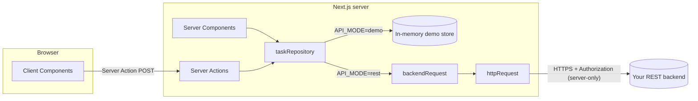

# Tích hợp REST API

Template không phụ thuộc ngôn ngữ backend (Java/Spring, .NET, Go, Node, Python...). Frontend chỉ cần một REST API trả về JSON.

## 1. Tổng quan



- Trình duyệt **không bao giờ** gọi backend trực tiếp. Mọi request đi qua server Next.js, nên `API_TOKEN` và URL nội bộ của backend không lộ ra ngoài.
- Backend có thể nằm trong mạng nội bộ; chỉ server Next.js cần truy cập được nó.

| File                                           | Vai trò                                                                               | Dùng ở đâu                     |
| ---------------------------------------------- | ------------------------------------------------------------------------------------- | ------------------------------ |
| `src/lib/api/http-client.ts`                   | `httpRequest()`: typed fetch, timeout, cancel, `ApiError`, validate response bằng Zod | Server và client               |
| `src/lib/api/backend.ts`                       | `backendRequest()`: thêm base URL, token và timeout từ env                            | **Chỉ server** (`server-only`) |
| `src/lib/env.ts`                               | Validate env                                                                          | **Chỉ server**                 |
| `src/features/*/services/rest-*-repository.ts` | Map endpoint của backend sang type của domain                                         | **Chỉ server**                 |
| `src/lib/action-result.ts`                     | Chuyển lỗi thành message an toàn cho UI                                               | Server Actions                 |

## 2. Chuyển từ demo sang backend thật

```bash
# .env.local
API_MODE=rest
API_BASE_URL=https://api.internal.example.com/v1
API_TOKEN=xxxxx            # tùy chọn: service-to-service token
API_TIMEOUT_MS=10000
```

Khởi động lại `pnpm dev`. Nếu thiếu `API_BASE_URL` hoặc URL sai format, server dừng ngay với thông báo:

```text
Invalid environment configuration:
✖ API_BASE_URL must be an absolute URL when API_MODE=rest
```

**Không cần sửa component nào.** Chỉ cần đảm bảo backend trả đúng contract ở mục 3, hoặc chỉnh lại adapter (mục 4).

## 3. Contract mặc định của Tasks

`src/features/tasks/services/rest-task-repository.ts` mong đợi backend như sau:

| Method | Path                                | Body                 | Response                                   |
| ------ | ----------------------------------- | -------------------- | ------------------------------------------ |
| GET    | `/tasks?q=&status=&page=&pageSize=` |                      | `{ items: Task[], total, page, pageSize }` |
| GET    | `/tasks/stats`                      |                      | `{ total, todo, in_progress, done }`       |
| POST   | `/tasks`                            | `TaskInput`          | `Task` (201)                               |
| PATCH  | `/tasks/{id}`                       | `Partial<TaskInput>` | `Task`                                     |
| DELETE | `/tasks/{id}`                       |                      | 204                                        |

Ví dụ request và response:

```http
POST /v1/tasks
Authorization: Bearer <API_TOKEN>
Content-Type: application/json

{ "title": "Write docs", "description": "", "status": "todo", "priority": "high", "dueDate": "2026-12-31" }
```

```json
{
  "id": "9f1c…",
  "title": "Write docs",
  "description": "",
  "status": "todo",
  "priority": "high",
  "dueDate": "2026-12-31",
  "createdAt": "2026-10-20T09:00:00Z",
  "updatedAt": "2026-10-20T09:00:00Z"
}
```

Response được validate bằng `taskSchema`. Nếu backend trả sai shape (thiếu field, sai kiểu), request sẽ throw `ApiError` với code `INVALID_RESPONSE`. Lỗi được phát hiện ngay tại ranh giới thay vì làm vỡ UI ở chỗ khác.

## 4. Backend có contract khác?

Chỉ sửa **adapter**. Ví dụ backend Spring trả về snake_case, bọc trong `data`, và đánh page từ 0:

```ts
// rest-task-repository.ts
const backendTaskSchema = z
  .object({
    id: z.number(),
    title: z.string(),
    description: z.string().nullable(),
    status: z.enum(['TODO', 'IN_PROGRESS', 'DONE']),
    priority: z.enum(['LOW', 'MEDIUM', 'HIGH']),
    due_date: z.string().nullable(),
    created_at: z.string(),
    updated_at: z.string(),
  })
  .transform((t): Task => ({
    id: String(t.id),
    title: t.title,
    description: t.description ?? '',
    status: t.status.toLowerCase() as Task['status'],
    priority: t.priority.toLowerCase() as Task['priority'],
    dueDate: t.due_date,
    createdAt: t.created_at,
    updatedAt: t.updated_at,
  }))

const springPageSchema = z.object({
  content: z.array(backendTaskSchema),
  totalElements: z.number(),
  number: z.number(),
  size: z.number(),
})

export const restTaskRepository: TaskRepository = {
  list: async ({ q, status, page, pageSize }) => {
    const res = await backendRequest('/tasks', {
      query: { search: q, status: status?.toUpperCase(), page: page - 1, size: pageSize },
      schema: springPageSchema,
    })
    return {
      items: res.content,
      total: res.totalElements,
      page: res.number + 1,
      pageSize: res.size,
    }
  },
  // …
}
```

UI vẫn chỉ biết type `Task`.

## 5. Xử lý lỗi

`httpRequest` chuyển mọi lỗi thành `ApiError { status, code, message, details }`:

| Tình huống                          | `code`                    | `status`                      |
| ----------------------------------- | ------------------------- | ----------------------------- |
| 404                                 | `NOT_FOUND`               | 404                           |
| 400 / 422                           | `VALIDATION_ERROR`        | 400/422; `details` = body lỗi |
| 4xx/5xx khác                        | `HTTP_ERROR`              | status thật                   |
| Không kết nối được (DNS, refused)   | `NETWORK_ERROR`           | 0                             |
| Quá `timeoutMs`                     | `TIMEOUT`                 | 0                             |
| Response sai schema                 | `INVALID_RESPONSE`        | status thật                   |
| Người gọi tự hủy (`signal.abort()`) | Throw nguyên `AbortError` |                               |

Message được lấy từ body lỗi theo thứ tự `detail` → `message` → `error` → `title`. Thứ tự này khớp với RFC 7807 Problem Details (Spring Boot 3, ASP.NET) và các format phổ biến khác.

Lỗi được hiển thị ra sao:

- **Server Action** → `toActionFailure()`:
  - `VALIDATION_ERROR` (400/422), `NOT_FOUND`, `TIMEOUT`, `NETWORK_ERROR`: hiển thị message cho người dùng.
  - 401/403, các 4xx khác, 5xx và lỗi không xác định: chỉ log ở server; người dùng thấy "Something went wrong". Các lỗi này thường mô tả cấu hình server (ví dụ service token sai) hoặc chi tiết nội bộ.
- **Client gọi Server Action** → bọc bằng `callAction()` (`src/lib/action-result.ts`). Nếu chính lời gọi bị reject (mất mạng, bản deploy mới không còn action cũ), người dùng thấy lỗi ngay trong form thay vì cả trang bị thay bằng error boundary.
- **Server Component** (đọc dữ liệu) → lỗi được throw ra và `app/(app)/error.tsx` bắt, hiển thị Alert kèm nút "Try again", trong khi sidebar và header vẫn dùng được.
- **Lỗi validation từ backend** (422): muốn hiện lỗi trên từng field, hãy map `error.details` sang `fieldErrors` trong action:

```ts
} catch (error) {
  if (error instanceof ApiError && error.code === 'VALIDATION_ERROR') {
    const details = error.details as { errors?: Record<string, string[]> }
    return { ok: false, error: error.message, fieldErrors: details.errors }
  }
  return toActionFailure(error)
}
```

## 6. Timeout và cancel

```ts
// timeout riêng cho một request chậm
await backendRequest('/reports/export', { timeoutMs: 60_000 })

// cancel (ví dụ ở client khi component unmount)
const controller = new AbortController()
httpRequest('/api/search?q=x', { signal: controller.signal })
controller.abort()
```

Signal hủy của người gọi và signal timeout được gộp bằng `AbortSignal.any`.

## 7. Client-side fetching và TanStack Query

Template **chưa** cài TanStack Query, vì demo không có trường hợp nào thật sự cần:

- Đọc dữ liệu: Server Components (render sẵn trên server, không cần loading spinner khi tải trang lần đầu).
- Ghi dữ liệu: Server Actions kèm `revalidatePath`.
- Filter, search, phân trang: lưu trên URL.

Nên thêm TanStack Query khi có các nhu cầu sau:

- Polling hoặc dữ liệu realtime (`refetchInterval`).
- Infinite scroll.
- Autocomplete hoặc search-as-you-type cần cache theo từng ký tự gõ.
- Nhiều component client cùng dùng một dữ liệu server, cần cache và dedupe.
- Optimistic update phức tạp trên nhiều danh sách.

Cách làm: client **không** gọi backend trực tiếp, mà gọi một **Route Handler** (BFF) của chính Next.js:

```ts
// src/app/api/tasks/route.ts. Chạy ở server nên dùng được token.
import { taskListQuerySchema, TASK_PAGE_SIZE } from '@/features/tasks/schemas'
import { taskRepository } from '@/features/tasks/services/task-repository'

export async function GET(request: Request) {
  // TODO(auth): kiểm tra session trước khi trả dữ liệu
  const params = Object.fromEntries(new URL(request.url).searchParams)
  const query = taskListQuerySchema.parse(params)
  return Response.json(await taskRepository.list({ ...query, pageSize: TASK_PAGE_SIZE }))
}
```

```tsx
// Client Component, sau khi `pnpm add @tanstack/react-query` và thêm QueryClientProvider trong src/providers/
'use client'
import { useQuery } from '@tanstack/react-query'

import { httpRequest } from '@/lib/api/http-client'
import { taskPageSchema } from '@/features/tasks/schemas'

export function useTasks(q: string) {
  return useQuery({
    queryKey: ['tasks', q],
    queryFn: ({ signal }) =>
      httpRequest(`/api/tasks?q=${encodeURIComponent(q)}`, { schema: taskPageSchema, signal }),
  })
}
```

Không có TanStack thì `httpRequest` + `useEffect` vẫn hoạt động. Chỉ thêm thư viện khi cần cache.

Tham khảo thêm: `node_modules/next/dist/docs/01-app/02-guides/client-side-data-fetching/tanstack-query.md`.

## 8. Authentication

Template **không** cài thư viện auth, vì cơ chế đăng nhập phụ thuộc vào backend của bạn. Thay vào đó, template định nghĩa một **contract** và mặc định **fail-closed** (từ chối khi chưa cấu hình).

### Contract

| Thành phần                    | File                       | Vai trò                                                                                                              |
| ----------------------------- | -------------------------- | -------------------------------------------------------------------------------------------------------------------- |
| `Session`                     | `src/lib/auth.ts`          | `{ userId, permissions, accessToken? }`: những gì app cần biết về người gọi                                          |
| `resolveSession()`            | `src/lib/auth-provider.ts` | **Hàm duy nhất bạn cần viết.** Trả về `Session`, hoặc `null` khi chưa đăng nhập. Mặc định trả `null`                 |
| `getSession()`                | `src/lib/auth.ts`          | Demo mode → session demo; `AUTH_ALLOW_ANONYMOUS=true` → session ẩn danh; còn lại → `resolveSession()`                |
| `requireSession(permission?)` | `src/lib/auth.ts`          | Throw `AuthError` (`unauthenticated` hoặc `forbidden`); `toActionFailure()` đổi lỗi này thành message cho người dùng |

### Nơi kiểm tra

| Lớp                | Cách kiểm tra                                                                                                     |
| ------------------ | ----------------------------------------------------------------------------------------------------------------- |
| Server Action      | `await requireSession('<feature>:write')` là **dòng đầu tiên** trong `try`, trước cả bước validate                |
| Page (đọc dữ liệu) | `if (!(await getSession()))` thì hiển thị "Sign-in required" (bên trong `<Suspense>`)                             |
| `backendRequest()` | Luôn gọi `requireSession()` trước `fetch`. Nếu page hay action quên kiểm tra, request vẫn không tới được backend  |
| Backend            | Kiểm tra quyền chi tiết (sở hữu dữ liệu, tenant) dựa trên `accessToken` của user. Frontend chỉ là lớp bảo vệ thêm |

`backendRequest()` gửi `session.accessToken` nếu có; chỉ khi không có mới dùng `API_TOKEN`. Hãy trả `accessToken` từ `resolveSession()` để backend biết **ai** đang gọi. Nếu không, mọi người dùng đã đăng nhập sẽ dùng chung quyền của service token.

### Ví dụ hiện thực `resolveSession()`

```ts
// src/lib/auth-provider.ts. Ví dụ: backend cấp JWT, lưu trong cookie httpOnly.
import 'server-only'
import { cookies } from 'next/headers'

import type { Session } from './auth'

export async function resolveSession(): Promise<Session | null> {
  const token = (await cookies()).get('access_token')?.value
  if (!token) return null
  // Xác thực token: verify chữ ký JWT bằng public key/JWKS của backend, hoặc gọi GET /me.
  const me = await fetch(`${process.env.API_BASE_URL}/me`, {
    headers: { Authorization: `Bearer ${token}` },
    cache: 'no-store',
  })
  if (!me.ok) return null
  const user = (await me.json()) as { id: string; permissions: string[] }
  return { userId: user.id, permissions: user.permissions, accessToken: token }
}
```

| Mô hình backend                      | Gợi ý                                                                                                                |
| ------------------------------------ | -------------------------------------------------------------------------------------------------------------------- |
| JWT hoặc access token do backend cấp | Như ví dụ trên; cookie `httpOnly; Secure; SameSite=Lax`, được set bởi route login (Route Handler hoặc Server Action) |
| OIDC (Keycloak, Entra ID, Auth0...)  | Dùng thư viện OIDC phù hợp; `resolveSession()` đọc session của thư viện đó                                           |
| Session cookie do backend quản lý    | `resolveSession()` gọi `/me` kèm cookie; chuyển tiếp cookie đó trong `backendRequest()`                              |

### Những phần phụ thuộc backend, cần quyết định khi tích hợp

- Màn hình login và logout: route group `src/app/(auth)/`, cùng một `AuthTemplate` nếu cần.
- Refresh token và thời hạn session.
- Danh sách permission (`orders:read`, `orders:write`...) và cách backend trả về.
- Có redirect người chưa đăng nhập ở `src/proxy.ts` hay không (chỉ là lớp UX; không thay thế việc kiểm tra ở action và data).

### Lưu ý

- **Không** lưu token trong `localStorage`: bất kỳ script nào chạy trên trang (XSS) đều đọc được.
- **Không** đặt token hay URL nội bộ trong biến `NEXT_PUBLIC_*`.
- `AUTH_ALLOW_ANONYMOUS=true` làm **mọi** visitor có toàn quyền của `API_TOKEN`. Server sẽ in cảnh báo khi khởi động. Chỉ dùng khi app đã được bảo vệ ở phía trước (VPN, SSO gateway).
- Repository không đi qua REST (ví dụ gọi thẳng DB) phải tự gọi `requireSession()`.

## 9. Checklist bảo mật

- [ ] Secret chỉ nằm trong env server (không có prefix `NEXT_PUBLIC_`), không commit `.env.local`.
- [ ] File dùng secret có `import 'server-only'`.
- [ ] Input của Server Action và Route Handler được validate bằng Zod.
- [ ] Response từ backend được validate bằng schema.
- [ ] Không trả message lỗi 5xx hay stack trace cho client.
- [ ] Backend tự kiểm tra authorization; frontend chỉ là lớp bảo vệ thêm.
- [ ] CORS: không cần mở, vì trình duyệt không gọi backend trực tiếp.
