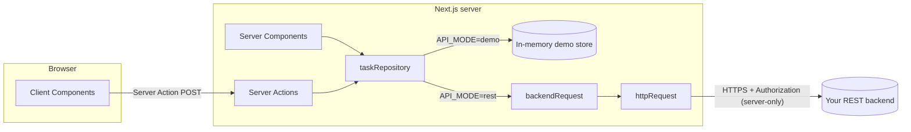

# REST API integration

The template does not depend on the backend language (Java/Spring, .NET, Go, Node, Python...). The frontend only needs a REST API that returns JSON.

## 1. Overview



- The browser **never** calls the backend directly. Every request goes through the Next.js server, so `API_TOKEN` and the backend's internal URL are never exposed.
- The backend can live on an internal network; only the Next.js server needs to reach it.

| File                                           | Role                                                                                       | Used where                      |
| ---------------------------------------------- | ------------------------------------------------------------------------------------------ | ------------------------------- |
| `src/lib/api/http-client.ts`                   | `httpRequest()`: typed fetch, timeout, cancel, `ApiError`, validates the response with Zod | Server and client               |
| `src/lib/api/backend.ts`                       | `backendRequest()`: adds base URL, token and timeout from env                              | **Server only** (`server-only`) |
| `src/lib/env.ts`                               | Validates env                                                                              | **Server only**                 |
| `src/features/*/services/rest-*-repository.ts` | Maps backend endpoints to domain types                                                     | **Server only**                 |
| `src/lib/action-result.ts`                     | Turns errors into safe messages for the UI                                                 | Server Actions                  |

## 2. Switching from demo to a real backend

```bash
# .env.local
API_MODE=rest
API_BASE_URL=https://api.internal.example.com/v1
API_TOKEN=xxxxx            # optional: service-to-service token
API_TIMEOUT_MS=10000
```

Restart `pnpm dev`. If `API_BASE_URL` is missing or the URL is malformed, the server stops immediately with this message:

```text
Invalid environment configuration:
✖ API_BASE_URL must be an absolute URL when API_MODE=rest
```

**No component needs to change.** Just make sure the backend returns the contract in section 3, or adjust the adapter (section 4).

## 3. Default Tasks contract

`src/features/tasks/services/rest-task-repository.ts` expects the backend to look like this:

| Method | Path                                | Body                 | Response                                   |
| ------ | ----------------------------------- | -------------------- | ------------------------------------------ |
| GET    | `/tasks?q=&status=&page=&pageSize=` |                      | `{ items: Task[], total, page, pageSize }` |
| GET    | `/tasks/stats`                      |                      | `{ total, todo, in_progress, done }`       |
| POST   | `/tasks`                            | `TaskInput`          | `Task` (201)                               |
| PATCH  | `/tasks/{id}`                       | `Partial<TaskInput>` | `Task`                                     |
| DELETE | `/tasks/{id}`                       |                      | 204                                        |

Example request and response:

```http
POST /v1/tasks
Authorization: Bearer <API_TOKEN>
Content-Type: application/json

{ "title": "Write docs", "description": "", "status": "todo", "priority": "high", "dueDate": "2026-12-31" }
```

```json
{
  "id": "9f1c…",
  "title": "Write docs",
  "description": "",
  "status": "todo",
  "priority": "high",
  "dueDate": "2026-12-31",
  "createdAt": "2026-10-20T09:00:00Z",
  "updatedAt": "2026-10-20T09:00:00Z"
}
```

The response is validated with `taskSchema`. If the backend returns the wrong shape (missing field, wrong type), the request throws `ApiError` with code `INVALID_RESPONSE`. The error is caught right at the boundary instead of breaking the UI somewhere else.

Parts of the contract the template assumes but does not enforce. Check them against your backend:

- **Order of `GET /tasks`**: the dashboard's "Recently updated" card shows the first page as returned. The demo store sorts by `updatedAt` descending; the REST adapter sends no sort parameter. If your backend's default order differs, send its sort parameter (e.g. `sort=-updatedAt`) in `rest-task-repository.ts`.
- **Id format**: `taskSchema.id` accepts any string, but edits and deletes only accept ids matching `^[A-Za-z0-9_-]{1,100}$` (`taskIdSchema`). Ids with other characters (`.`, `:`, `/`) list fine and then fail with "Invalid task id". If your ids look like that, widen `taskIdSchema` only to characters that are safe in a URL path segment, or use `taskIdSchema` inside `taskSchema` so a mismatch fails loudly on read.

## 4. Backend with a different contract?

Change only the **adapter**. Example: a Spring backend that returns snake_case, wraps results in `data`, and numbers pages from 0:

```ts
// rest-task-repository.ts
const backendTaskSchema = z
  .object({
    id: z.number(),
    title: z.string(),
    description: z.string().nullable(),
    status: z.enum(['TODO', 'IN_PROGRESS', 'DONE']),
    priority: z.enum(['LOW', 'MEDIUM', 'HIGH']),
    due_date: z.string().nullable(),
    created_at: z.string(),
    updated_at: z.string(),
  })
  .transform((t): Task => ({
    id: String(t.id),
    title: t.title,
    description: t.description ?? '',
    status: t.status.toLowerCase() as Task['status'],
    priority: t.priority.toLowerCase() as Task['priority'],
    dueDate: t.due_date,
    createdAt: t.created_at,
    updatedAt: t.updated_at,
  }))

const springPageSchema = z.object({
  content: z.array(backendTaskSchema),
  totalElements: z.number(),
  number: z.number(),
  size: z.number(),
})

export const restTaskRepository: TaskRepository = {
  list: async ({ q, status, page, pageSize }) => {
    const res = await backendRequest('/tasks', {
      query: { search: q, status: status?.toUpperCase(), page: page - 1, size: pageSize },
      schema: springPageSchema,
    })
    return {
      items: res.content,
      total: res.totalElements,
      page: res.number + 1,
      pageSize: res.size,
    }
  },
  // …
}
```

The UI still only knows the `Task` type.

## 5. Error handling

`httpRequest` turns every error into `ApiError { status, code, message, details }`:

| Situation                         | `code`                             | `status`                        |
| --------------------------------- | ---------------------------------- | ------------------------------- |
| 404                               | `NOT_FOUND`                        | 404                             |
| 400 / 422                         | `VALIDATION_ERROR`                 | 400/422; `details` = error body |
| Other 4xx/5xx                     | `HTTP_ERROR`                       | actual status                   |
| Cannot connect (DNS, refused)     | `NETWORK_ERROR`                    | 0                               |
| Exceeds `timeoutMs`               | `TIMEOUT`                          | 0                               |
| Response does not match schema    | `INVALID_RESPONSE`                 | actual status                   |
| Caller cancels (`signal.abort()`) | Rethrows the original `AbortError` |                                 |

The message is taken from the error body in this order: `detail` → `message` → `error` → `title`. This order matches RFC 7807 Problem Details (Spring Boot 3, ASP.NET) and other common formats.

How errors are shown:

- **Server Action** → `toActionFailure()`:
  - `VALIDATION_ERROR` (400/422), `NOT_FOUND`, `TIMEOUT`, `NETWORK_ERROR`: the message is shown to the user.
  - 401: the user's token was rejected (usually an expired session); the user sees the fixed "Please sign in and try again" message. No backend text is shown.
  - 403, other 4xx, 5xx and unknown errors: logged on the server only; the user sees "Something went wrong". These errors usually describe server configuration (for example a wrong service token) or internal details.
- **Client calling a Server Action** → wrap it with `callAction()` (`src/lib/action-result.ts`). If the call itself is rejected (network lost, a new deployment no longer has the old action), the user sees the error inside the form instead of the whole page being replaced by the error boundary.
- **Server Component** (reading data) → the error is thrown and caught by `app/(app)/error.tsx`, which shows an Alert with a "Try again" button, while the sidebar and header remain usable.
- **Validation errors from the backend** (422): to show errors on individual fields, map `error.details` to `fieldErrors` in the action:

```ts
} catch (error) {
  if (error instanceof ApiError && error.code === 'VALIDATION_ERROR') {
    const details = error.details as { errors?: Record<string, string[]> }
    return { ok: false, error: error.message, fieldErrors: details.errors }
  }
  return toActionFailure(error)
}
```

## 6. Timeout and cancel

```ts
// custom timeout for one slow request
await backendRequest('/reports/export', { timeoutMs: 60_000 })

// cancel (for example on the client when the component unmounts)
const controller = new AbortController()
httpRequest('/api/search?q=x', { signal: controller.signal })
controller.abort()
```

The caller's cancel signal and the timeout signal are combined with `AbortSignal.any`.

Known limit: the timeout is mapped to `TIMEOUT` only while waiting for the response headers. If it fires while the body is still streaming (a large or slow response), the raw `TimeoutError` propagates and the user sees the generic message. If you have slow, large responses, move `readBody()` in `src/lib/api/http-client.ts` into the same error mapping as `fetch`.

## 7. Client-side fetching and TanStack Query

The template does **not** install TanStack Query yet, because the demo has no case that really needs it:

- Reading data: Server Components (rendered on the server, so no loading spinner is needed on the first page load).
- Writing data: Server Actions with `revalidatePath`.
- Filter, search, pagination: stored in the URL.

Add TanStack Query when you need the following:

- Polling or realtime data (`refetchInterval`).
- Infinite scroll.
- Autocomplete or search-as-you-type that needs a cache per keystroke.
- Several client components using the same server data, needing caching and dedupe.
- Complex optimistic updates across several lists.

How to do it: the client does **not** call the backend directly; it calls a **Route Handler** (BFF) of the Next.js app itself:

```ts
// src/app/api/tasks/route.ts. Runs on the server, so it can use the token.
import { taskListQuerySchema, TASK_PAGE_SIZE } from '@/features/tasks/schemas'
import { taskRepository } from '@/features/tasks/services/task-repository'

export async function GET(request: Request) {
  // TODO(auth): check the session before returning data
  const params = Object.fromEntries(new URL(request.url).searchParams)
  const query = taskListQuerySchema.parse(params)
  return Response.json(await taskRepository.list({ ...query, pageSize: TASK_PAGE_SIZE }))
}
```

```tsx
// Client Component, after `pnpm add @tanstack/react-query` and adding QueryClientProvider in src/providers/
'use client'
import { useQuery } from '@tanstack/react-query'

import { httpRequest } from '@/lib/api/http-client'
import { taskPageSchema } from '@/features/tasks/schemas'

export function useTasks(q: string) {
  return useQuery({
    queryKey: ['tasks', q],
    queryFn: ({ signal }) =>
      httpRequest(`/api/tasks?q=${encodeURIComponent(q)}`, { schema: taskPageSchema, signal }),
  })
}
```

Without TanStack, `httpRequest` + `useEffect` still works. Only add the library when you need caching.

Further reading: `node_modules/next/dist/docs/01-app/02-guides/client-side-data-fetching/tanstack-query.md`.

## 8. Authentication

The template does **not** install an auth library, because the sign-in mechanism depends on your backend. Instead, the template defines a **contract** and is **fail-closed** by default (it denies access until configured).

### Contract

| Part                          | File                       | Role                                                                                                                                                                                                                                                   |
| ----------------------------- | -------------------------- | ------------------------------------------------------------------------------------------------------------------------------------------------------------------------------------------------------------------------------------------------------ |
| `Session`                     | `src/lib/auth.ts`          | `{ userId, permissions, accessToken? }`: what the app needs to know about the caller                                                                                                                                                                   |
| `resolveSession()`            | `src/lib/auth-provider.ts` | **The only function you need to write.** Returns a `Session`, or `null` when not signed in. Returns `null` by default                                                                                                                                  |
| `getSession()`                | `src/lib/auth.ts`          | Demo mode → demo session; `AUTH_ALLOW_ANONYMOUS=true` → anonymous session; otherwise → `resolveSession()`. Memoized per request with React `cache()`, so `resolveSession()` runs once per render even though pages and `backendRequest()` both call it |
| `hasPermission(session, p)`   | `src/lib/auth.ts`          | `true` when the session has `p` or `'*'`. For pages that render a "Permission required" state instead of throwing                                                                                                                                      |
| `requireSession(permission?)` | `src/lib/auth.ts`          | Throws `AuthError` (`unauthenticated` or `forbidden`); `toActionFailure()` turns this error into a message for the user                                                                                                                                |

### Permissions

Each feature declares two plain strings in its `constants.ts`, for example `tasks:read` and `tasks:write`. Write does **not** imply read: give a user both if they should see and change data. `'*'` grants everything (demo and anonymous sessions use it). `resolveSession()` returns the permissions your backend assigns to the user.

### Where checks happen

| Layer                | How it checks                                                                                                                                                    |
| -------------------- | ---------------------------------------------------------------------------------------------------------------------------------------------------------------- |
| Server Action        | `await requireSession('<feature>:write')` is the **first line** in `try`, even before validation                                                                 |
| Page (reading data)  | `const session = await getSession()`: no session → "Sign-in required"; `!hasPermission(session, '<feature>:read')` → "Permission required" (inside `<Suspense>`) |
| REST adapter (reads) | `list`/`stats` call `requireSession('<feature>:read')` before `backendRequest()`. If a page forgets its check, the data still is not fetched                     |
| `backendRequest()`   | Always calls `requireSession()` before `fetch`. If a page or action forgets to check, the request still cannot reach the backend                                 |
| Backend              | Checks fine-grained permissions (data ownership, tenant) based on the user's `accessToken`. The frontend is only an extra layer of protection                    |

`backendRequest()` sends `session.accessToken` if present; only when it is absent does it use `API_TOKEN`. Return `accessToken` from `resolveSession()` so the backend knows **who** is calling. Otherwise, every signed-in user shares the permissions of the service token.

### Example implementation of `resolveSession()`

```ts
// src/lib/auth-provider.ts. Example: the backend issues a JWT, stored in an httpOnly cookie.
import 'server-only'
import { cookies } from 'next/headers'

import type { Session } from './auth'

export async function resolveSession(): Promise<Session | null> {
  const token = (await cookies()).get('access_token')?.value
  if (!token) return null
  // Validate the token: verify the JWT signature with the backend's public key/JWKS, or call GET /me.
  const me = await fetch(`${process.env.API_BASE_URL}/me`, {
    headers: { Authorization: `Bearer ${token}` },
    cache: 'no-store',
  })
  if (!me.ok) return null
  const user = (await me.json()) as { id: string; permissions: string[] }
  return { userId: user.id, permissions: user.permissions, accessToken: token }
}
```

| Backend model                             | Suggestion                                                                                                                |
| ----------------------------------------- | ------------------------------------------------------------------------------------------------------------------------- |
| JWT or access token issued by the backend | As in the example above; cookie `httpOnly; Secure; SameSite=Lax`, set by the login route (Route Handler or Server Action) |
| OIDC (Keycloak, Entra ID, Auth0...)       | Use a suitable OIDC library; `resolveSession()` reads that library's session                                              |
| Session cookie managed by the backend     | `resolveSession()` calls `/me` with the cookie; forward that cookie in `backendRequest()`                                 |

### Backend-dependent parts to decide during integration

- Login and logout screens: route group `src/app/(auth)/`, plus an `AuthTemplate` if needed.
- Refresh tokens and session lifetime.
- The list of permissions (`orders:read`, `orders:write`...) and how the backend returns them.
- Whether to redirect signed-out users in `src/proxy.ts` (this is only a UX layer; it does not replace the checks in actions and data access).

### Notes

- Do **not** store tokens in `localStorage`: any script running on the page (XSS) can read them.
- Do **not** put tokens or internal URLs in `NEXT_PUBLIC_*` variables.
- `AUTH_ALLOW_ANONYMOUS=true` gives **every** visitor the full permissions of `API_TOKEN`. The server prints a warning on startup. Use it only when the app is already protected in front (VPN, SSO gateway).
- A repository that does not go through REST (for example one that calls the DB directly) must call `requireSession()` itself. The demo repository (`demo-task-repository.ts`) skips this only because the demo session always has `'*'`; do not copy that part into a real repository.
- `API_MODE` defaults to `demo`. A production build started without `API_MODE=rest` serves in-memory data that any visitor can change; the server prints an `[env]` warning on startup.

## 9. Security checklist

- [ ] Secrets live only in server env (no `NEXT_PUBLIC_` prefix); `.env.local` is not committed.
- [ ] Files that use secrets have `import 'server-only'`.
- [ ] Server Action and Route Handler input is validated with Zod.
- [ ] Backend responses are validated with a schema.
- [ ] 5xx error messages and stack traces are not returned to the client.
- [ ] The backend checks authorization itself; the frontend is only an extra layer of protection.
- [ ] CORS: no need to enable it, because the browser does not call the backend directly.
