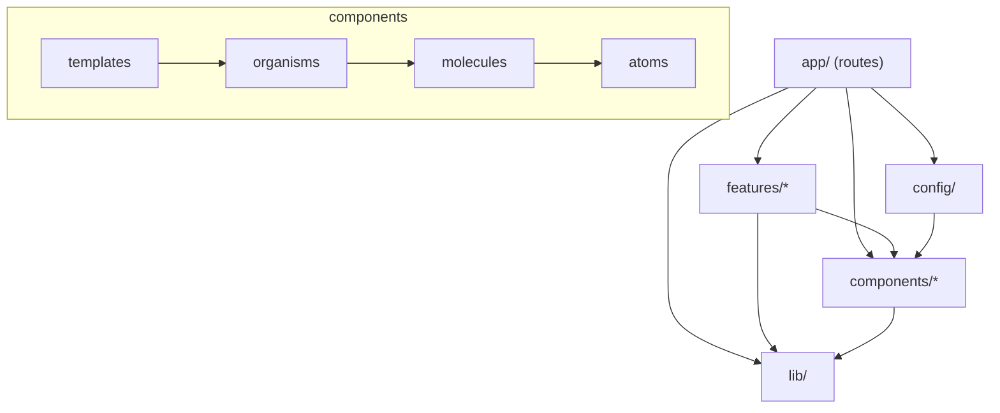
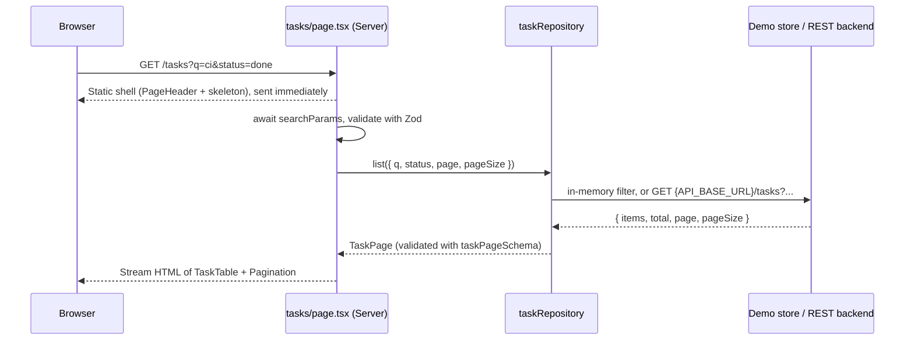
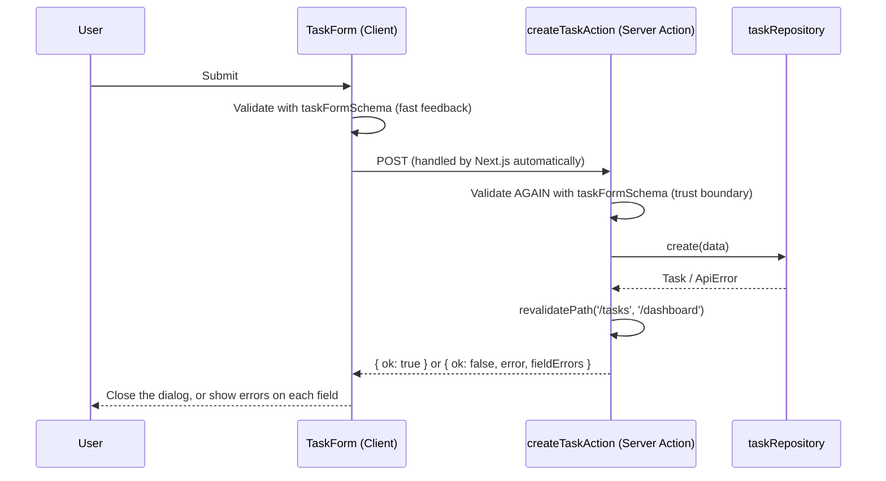

# Architecture

> References: [Atomic Design, Brad Frost, chapter 2](https://atomicdesign.bradfrost.com/chapter-2/) and [Atomic Web Design (2013)](https://bradfrost.com/blog/post/atomic-web-design/). Both pages were read while designing this template.

## 1. Why Hybrid Atomic Design + Feature-Based?

Each way of organizing code solves a different problem:

| Question                                                                      | Answer                                     |
| ----------------------------------------------------------------------------- | ------------------------------------------ |
| "What do buttons, inputs, tables... look like, and how do they fit together?" | **Atomic Design** (`src/components/`)      |
| "What does the _Task_ feature consist of: data, validation, API, screens?"    | **Feature module** (`src/features/tasks/`) |
| "Which URL shows which screen?"                                               | **Next.js App Router** (`src/app/`)        |

If you apply Atomic Design to the **whole** application, everything gets forced into 5 levels. For example, `TaskCard` becomes a "molecule" and `TaskForm` becomes an "organism". The result is that the business code of one feature gets scattered all over `components/`, and to delete or change a feature you have to dig through many folders.

If you **only** use feature folders, each feature writes its own Button and Dialog, and the UI gradually loses consistency.

Combining the two approaches:

- `components/` holds UI that **knows nothing about the business domain** and can be reused in any project.
- `features/` holds everything that belongs to one feature.

Compared with the backend: `components/` is like a shared library (such as `commons-lang`), while `features/` is like a module or a bounded context.

## 2. The five levels of Atomic Design

According to Brad Frost, Atomic Design is a **mental model**, not a linear process or a dogma. He writes: "Atomic design is not a linear process" and "not rigid dogma".

| Level         | Definition (Brad Frost)                                                                                                | In the template         | Examples                                                                                                                                                                      |
| ------------- | ---------------------------------------------------------------------------------------------------------------------- | ----------------------- | ----------------------------------------------------------------------------------------------------------------------------------------------------------------------------- |
| **Atoms**     | Basic UI elements that cannot be broken down further and still be useful                                               | `components/atoms/`     | `Button`, `Input`, `Select`, `Textarea`, `Checkbox`, `Label`, `Badge`, `Spinner`, `Skeleton`, `Separator`, `Card`                                                             |
| **Molecules** | Small groups of atoms that work together as a unit and do one thing                                                    | `components/molecules/` | `FormField` (Label + control + error), `SearchInput`, `Dialog`, `ConfirmationDialog`, `Pagination`, `EmptyState`, `Alert`, `StatCard`, `PageHeader`, `NavMenu`, `ThemeToggle` |
| **Organisms** | Relatively complex parts of the interface that form a distinct section                                                 | `components/organisms/` | `AppSidebar`, `AppHeader`, `MobileNav`, `DataTable`                                                                                                                           |
| **Templates** | Page-level layouts that place components into a layout; they focus on the **content structure**, not the final content | `components/templates/` | `DashboardTemplate` (sidebar + header + main frame, accepts slots)                                                                                                            |
| **Pages**     | Specific templates with **real content**; where the design system is tested                                            | `app/**/page.tsx`       | `app/(app)/tasks/page.tsx`                                                                                                                                                    |

Some classification choices need explaining:

- **`Card` is an atom.** By itself it is only a surface frame (border, background, rounded corners). Its sub-parts `CardHeader` and `CardTitle` are just slots for content.
- **`Dialog` is a molecule, not an atom.** It combines a title, a close button (`Button`) and modal behaviour. `ConfirmationDialog` is a molecule built from `Dialog`; this is **composition**, not a separate new modal.
- **`DataTable` is an organism.** It is a complete section of the page. It is still pure UI, because the feature decides the content of each cell (`TaskTable` passes in the `columns`).
- **There is no Typography component.** Tailwind classes (`text-2xl font-semibold`) together with `PageHeader` and `CardTitle` are enough. A `<Heading>` component that only wraps a few classes would be a redundant wrapper.
- **You do not have to go through all 5 levels.** `EmptyState` is used directly in a page; `TaskTable` uses `DataTable` directly.

### Template ≠ `layout.tsx`, Page ≠ `page.tsx`

| Concept                                   | What it is                                                                                        | What it knows                                                                                        |
| ----------------------------------------- | ------------------------------------------------------------------------------------------------- | ---------------------------------------------------------------------------------------------------- |
| `DashboardTemplate` (Atomic Template)     | A pure React component with only **slots** (`sidebar`, `header`, `children`)                      | Knows nothing about routes, data or the specific menu. Can be viewed in Storybook with fake content. |
| `app/(app)/layout.tsx` (Next.js layout)   | A **routing** file. Next.js automatically wraps every route in `(app)/` with this file.           | Gets `mainNavigation` and `siteConfig`, and **plugs** organisms into the template's slots            |
| `app/(app)/tasks/page.tsx` (Next.js page) | The entry point of the `/tasks` URL. In Atomic terms, this is the **Page**: template + real data. | Reads `searchParams`, calls the repository, combines the feature components                          |

In short: Next.js `layout.tsx` and `page.tsx` are **routing mechanisms**. Atomic Template and Page are **design concepts**. In this template, `page.tsx` plays the role of the Atomic Page, while `layout.tsx` **uses** the Atomic Template rather than being it.

### Extensions beyond the original method

Brad Frost does not discuss data fetching, routing or business logic, because Atomic Design "has nothing to do with web-specific subjects like CSS or JavaScript architecture". The following are additions made by this template:

1. **Feature modules** for business logic (section 1).
2. **Design tokens** (colours, radius, shadow, font) live in CSS variables in `globals.css`. Brad puts "color palettes, fonts" in the group of abstract atoms; here they are tokens, not components.
3. **Dependency rules** checked automatically by ESLint (section 4).

## 3. Responsibilities of each layer

```text
src/app/          Routing, layout, metadata, loading/error boundary. Combines features + templates.
                  Does NOT contain reusable components or business logic.
src/features/X/   Everything for business domain X: schema, types, service (data access),
                  Server Actions, X's own UI.
src/components/   Design system. Receives data only through props; does not call APIs,
                  does not import features.
src/lib/          Infrastructure: HTTP client, env, utilities. Does not know which features exist.
src/config/       App configuration: menu, app name.
```

## 4. Dependency rules

An arrow `A → B` means "A is allowed to import B":



- `components/**` and `lib/**` **must not** import `@/features/*` or `@/app/*`. ESLint `no-restricted-imports` reports an error on violation.
- `features/**` must not import `@/app/*`.
- Inside `components/`, higher levels import lower levels (`molecules → atoms`), never the other way round.
- Feature A should not import the internals of feature B. If something needs to be shared, move that part up to `components/` (if it is UI) or `lib/` (if it is logic).
- Do not use barrel files (`index.ts` re-exports). Barrels easily pull server code into the client bundle and easily create import cycles.

## 5. Server Components and Client Components

By default every component is a **Server Component**: it runs on the server, sends no JavaScript to the browser, and is allowed to read data directly.

Only add `'use client'` when the component needs at least one of the following: state (`useState`), effects, event handlers, or browser APIs.

| Client Components in the template                                                   | Why they need the client                    |
| ----------------------------------------------------------------------------------- | ------------------------------------------- |
| `Dialog`, `ConfirmationDialog`, `MobileNav`                                         | Call `showModal()`, manage open/close state |
| `NavMenu`                                                                           | `usePathname()` to mark the active link     |
| `ThemeToggle`                                                                       | Click handling, `localStorage`              |
| `TaskForm`, `TaskFormDialog`, `DeleteTaskButton`, `TaskStatusSelect`, `TaskFilters` | Forms, interaction, calling Server Actions  |

Everything else is server: `Button`, `Card`, `DataTable`, `Pagination`, `TaskTable`, `TaskStats`, the pages...

Components such as `Button` do not have `'use client'`. If they are imported from a Client Component, they run on the client; otherwise, they render on the server.

Some rules:

- **Keep the client boundary small.** `TaskTable` is server, and only the interactive cells (`TaskStatusSelect`, the buttons) are client.
- **Props crossing the boundary must be serializable.** For example: pass `icon={<ListTodo />}` (an element), not `icon={ListTodo}` (a function).
- **Secrets stay on the server only.** `src/lib/env.ts` and `src/lib/api/backend.ts` have `import 'server-only'`. If a Client Component imports them, **the build fails**.
- **Do not add global state.** Filter, search and page all live in the URL (`?q=&status=&page=`). Server data is fetched through Server Components.

## 6. Data flow

### Read



Next.js 16 enables **Cache Components**: the static part of the page is prerendered ahead of time, while dynamic data streams in inside `<Suspense>`.

- Data without `'use cache'` is always read fresh on every request.
- The dashboard page calls `await connection()` to make sure it does not get "frozen" into a build-time snapshot.
- If you want caching, see `node_modules/next/dist/docs/01-app/01-getting-started/08-caching.md`.

### Write (Mutation)



- **A Server Action is a public POST endpoint.** Anyone can call it directly, so you must validate the input again on the server and check permissions (auth) at the very start of each action.
- Actions **return** errors (`ActionResult`) instead of using `throw`. In production, Next.js replaces the message of a thrown error with a generic message, so the UI would not be able to show a useful error.
- 401/403/5xx errors and unknown errors are logged on the server; the user only sees a generic message.
- The client calls actions through `callAction()`: if the request itself fails (network loss), the error still shows up right in the form.

### Component tree of the Tasks screen

```text
app/(app)/layout.tsx
└── DashboardTemplate                       (template)
    ├── sidebar: AppSidebar                 (organism)
    │   └── NavMenu                         (molecule, client)
    ├── header: AppHeader                   (organism)
    │   ├── MobileNav → Dialog → NavMenu    (organism → molecule)
    │   └── ThemeToggle → Button            (molecule → atom)
    └── app/(app)/tasks/page.tsx            (Atomic "Page")
        ├── PageHeader                      (molecule)
        │   └── TaskFormDialog              (feature, client)
        │       └── Dialog → TaskForm → FormField → Input/Select/Textarea
        └── <Suspense> TaskList (async server)
            ├── TaskFilters → SearchInput, Select     (feature, client)
            ├── TaskTable → DataTable                 (feature → organism)
            │   ├── TaskStatusSelect → Select         (feature, client)
            │   ├── TaskPriorityBadge → Badge
            │   ├── TaskFormDialog (edit)
            │   └── DeleteTaskButton → ConfirmationDialog → Dialog
            └── Pagination                            (molecule)
```

## 7. Data access: Repository pattern

```text
features/tasks/types.ts          TaskRepository (contract: list, stats, create, update, remove)
features/tasks/services/
├── demo-task-repository.ts      Implementation 1: in-memory (demo, test)
├── rest-task-repository.ts      Implementation 2: REST via backendRequest()
└── task-repository.ts           Picks the implementation based on API_MODE (server-only)
```

The UI and Server Actions only know about `taskRepository`. When switching from the demo to a real backend, you only change env variables; no component needs to change. Details: [api-integration.md](api-integration.md).

## 8. Theme and design tokens

- **Tokens** live in `src/app/globals.css`, in `:root` (light) and `[data-theme='dark']`. Colours are written in OKLCH.
- `@theme inline` turns tokens into Tailwind utilities: `bg-primary`, `text-muted-foreground`, `rounded-md`, `shadow-sm`...
- **Components never hard-code colours.** To change the brand, you only need to edit the tokens.
- `themeInitScript` runs in `<head>` before the page is displayed, so there is no flash of the wrong theme. The script reads `localStorage`; if nothing is stored, it follows the operating system setting.

## 9. Authentication (contract, fail-closed)

The template does not pick a sign-in provider. It defines a contract and **denies by default** in REST mode. Details: [api-integration.md](api-integration.md), section 8.

```mermaid
flowchart LR
    SA[Server Action] -->|requireSession&#40;'x:write'&#41;| AUTH[lib/auth.ts]
    PG[Page] -->|getSession&#40;&#41;| AUTH
    BR[backendRequest] -->|requireSession&#40;&#41;| AUTH
    AUTH -->|demo| DEMO[(demo session)]
    AUTH -->|AUTH_ALLOW_ANONYMOUS| ANON[(anonymous session)]
    AUTH -->|rest| PROV[lib/auth-provider.ts<br/>resolveSession&#40;&#41;<br/>default: null]
```



| Task                                 | Where                                                                                |
| ------------------------------------ | ------------------------------------------------------------------------------------ |
| Read the user from a cookie or IdP   | `src/lib/auth-provider.ts` → `resolveSession()`                                      |
| Send the user's token to the backend | Return `accessToken` in `Session`; `backendRequest()` sends it automatically         |
| Check permissions on mutation        | `requireSession('<feature>:write')` at the start of each Server Action               |
| Login screen (not built yet)         | Route group `src/app/(auth)/login/page.tsx` + `AuthTemplate` when integrating an IdP |

Reading the session is a request-time API, so it must be inside `<Suspense>` (exactly as the `02-guides/authentication-with-cache-components.md` guide says). The template does **not** use `unauthorized()` or `forbidden()` because they are still experimental (`authInterrupts`).
