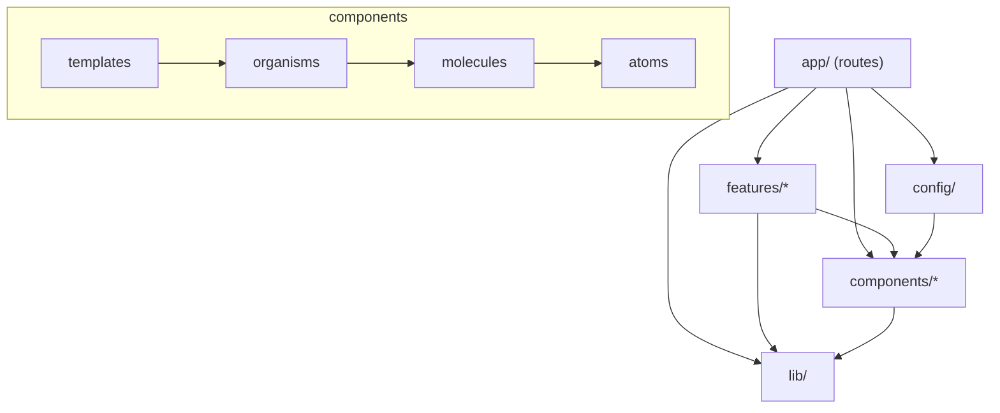
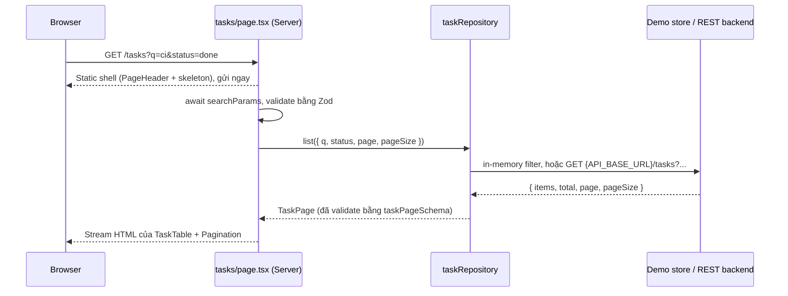
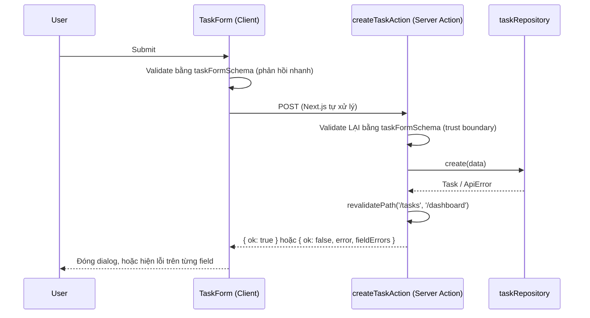

# Kiến trúc

> Nguồn tham khảo: [Atomic Design, Brad Frost, chương 2](https://atomicdesign.bradfrost.com/chapter-2/) và [Atomic Web Design (2013)](https://bradfrost.com/blog/post/atomic-web-design/). Cả hai trang đã được đọc khi thiết kế template này.

## 1. Vì sao chọn Hybrid Atomic Design + Feature-Based?

Mỗi cách tổ chức giải quyết một vấn đề khác nhau:

| Câu hỏi                                                              | Cách trả lời                               |
| -------------------------------------------------------------------- | ------------------------------------------ |
| "Nút bấm, ô input, bảng... trông thế nào và ghép với nhau ra sao?"   | **Atomic Design** (`src/components/`)      |
| "Chức năng _Task_ gồm những gì: dữ liệu, validation, API, màn hình?" | **Feature module** (`src/features/tasks/`) |
| "URL nào hiển thị màn hình nào?"                                     | **Next.js App Router** (`src/app/`)        |

Nếu áp Atomic Design cho **toàn bộ** ứng dụng, mọi thứ sẽ bị ép vào 5 cấp. Ví dụ `TaskCard` thành "molecule", `TaskForm` thành "organism". Kết quả là code nghiệp vụ của một chức năng bị rải khắp `components/`, và muốn xóa hay sửa một feature phải đi lục nhiều thư mục.

Nếu **chỉ** dùng feature folder, mỗi feature lại tự viết Button và Dialog của riêng nó, và UI dần mất nhất quán.

Kết hợp hai cách:

- `components/` chứa UI **không biết gì về nghiệp vụ**, dùng lại được ở mọi dự án.
- `features/` chứa mọi thứ thuộc về một chức năng.

So với backend: `components/` giống một thư viện dùng chung (như `commons-lang`), còn `features/` giống một module hoặc bounded context.

## 2. Năm cấp của Atomic Design

Theo Brad Frost, Atomic Design là **mô hình tư duy**, không phải quy trình tuyến tính hay giáo điều. Ông viết: "Atomic design is not a linear process" và "not rigid dogma".

| Cấp           | Định nghĩa (Brad Frost)                                                                                       | Trong template          | Ví dụ                                                                                                                                                                         |
| ------------- | ------------------------------------------------------------------------------------------------------------- | ----------------------- | ----------------------------------------------------------------------------------------------------------------------------------------------------------------------------- |
| **Atoms**     | Phần tử UI cơ bản, không chia nhỏ hơn mà vẫn còn hữu dụng được                                                | `components/atoms/`     | `Button`, `Input`, `Select`, `Textarea`, `Checkbox`, `Label`, `Badge`, `Spinner`, `Skeleton`, `Separator`, `Card`                                                             |
| **Molecules** | Nhóm nhỏ các atom hoạt động như một đơn vị, làm một việc                                                      | `components/molecules/` | `FormField` (Label + control + error), `SearchInput`, `Dialog`, `ConfirmationDialog`, `Pagination`, `EmptyState`, `Alert`, `StatCard`, `PageHeader`, `NavMenu`, `ThemeToggle` |
| **Organisms** | Phần giao diện tương đối phức tạp, tạo thành một khu vực riêng                                                | `components/organisms/` | `AppSidebar`, `AppHeader`, `MobileNav`, `DataTable`                                                                                                                           |
| **Templates** | Bố cục cấp trang, đặt các component vào layout; tập trung vào **cấu trúc nội dung**, không phải nội dung cuối | `components/templates/` | `DashboardTemplate` (khung sidebar + header + main, nhận các slot)                                                                                                            |
| **Pages**     | Template cụ thể với **nội dung thật**; nơi kiểm tra design system                                             | `app/**/page.tsx`       | `app/(app)/tasks/page.tsx`                                                                                                                                                    |

Một số lựa chọn phân loại cần giải thích:

- **`Card` là atom.** Bản thân nó chỉ là một khung bề mặt (border, nền, bo góc). Các phần con `CardHeader` và `CardTitle` chỉ là các khe đặt nội dung.
- **`Dialog` là molecule, không phải atom.** Nó ghép tiêu đề, nút đóng (`Button`) và hành vi modal. `ConfirmationDialog` là molecule được dựng từ `Dialog`; đây là **composition**, không tạo thêm một modal riêng.
- **`DataTable` là organism.** Nó là một khu vực hoàn chỉnh của trang. Nó vẫn là UI thuần, vì feature quyết định nội dung từng ô (`TaskTable` truyền các `columns` vào).
- **Không có Typography component.** Các class Tailwind (`text-2xl font-semibold`) cùng `PageHeader` và `CardTitle` đã đủ. Một component `<Heading>` chỉ bọc lại vài class sẽ là wrapper thừa.
- **Không bắt buộc đi qua đủ 5 cấp.** `EmptyState` dùng thẳng trong page; `TaskTable` dùng thẳng `DataTable`.

### Template ≠ `layout.tsx`, Page ≠ `page.tsx`

| Khái niệm                                 | Là gì                                                                                        | Biết gì                                                                               |
| ----------------------------------------- | -------------------------------------------------------------------------------------------- | ------------------------------------------------------------------------------------- |
| `DashboardTemplate` (Atomic Template)     | React component thuần, chỉ có **slot** (`sidebar`, `header`, `children`)                     | Không biết route, dữ liệu hay menu cụ thể. Xem được trong Storybook với nội dung giả. |
| `app/(app)/layout.tsx` (Next.js layout)   | File **routing**. Next.js tự bọc mọi route trong `(app)/` bằng file này.                     | Lấy `mainNavigation` và `siteConfig`, **lắp** organisms vào slot của template         |
| `app/(app)/tasks/page.tsx` (Next.js page) | Entry point của URL `/tasks`. Về mặt Atomic, đây chính là **Page**: template + dữ liệu thật. | Đọc `searchParams`, gọi repository, ghép các feature component                        |

Tóm lại: Next.js `layout.tsx` và `page.tsx` là **cơ chế routing**. Atomic Template và Page là **khái niệm thiết kế**. Ở template này, `page.tsx` đóng vai trò Atomic Page, còn `layout.tsx` **sử dụng** Atomic Template chứ không phải là nó.

### Phần mở rộng ngoài phương pháp gốc

Brad Frost không bàn tới data fetching, routing hay nghiệp vụ, vì Atomic Design "has nothing to do with web-specific subjects like CSS or JavaScript architecture". Các phần sau là bổ sung của template:

1. **Feature modules** cho nghiệp vụ (mục 1).
2. **Design tokens** (màu, radius, shadow, font) nằm trong CSS variables ở `globals.css`. Brad xếp "color palettes, fonts" vào nhóm atoms trừu tượng; ở đây chúng là token, không phải component.
3. **Quy tắc phụ thuộc** được ESLint kiểm tra tự động (mục 4).

## 3. Trách nhiệm của từng layer

```text
src/app/          Routing, layout, metadata, loading/error boundary. Ghép feature + template.
                  KHÔNG chứa component tái sử dụng hay business logic.
src/features/X/   Mọi thứ của nghiệp vụ X: schema, type, service (data access),
                  Server Action, UI riêng của X.
src/components/   Design system. Chỉ nhận dữ liệu qua props; không gọi API,
                  không import feature.
src/lib/          Hạ tầng: HTTP client, env, tiện ích. Không biết feature nào tồn tại.
src/config/       Cấu hình app: menu, tên app.
```

## 4. Quy tắc phụ thuộc (Dependency rules)

Mũi tên `A → B` nghĩa là "A được phép import B":



- `components/**` và `lib/**` **không được** import `@/features/*` hay `@/app/*`. ESLint `no-restricted-imports` báo lỗi nếu vi phạm.
- `features/**` không được import `@/app/*`.
- Trong `components/`, cấp cao import cấp thấp (`molecules → atoms`), không làm ngược lại.
- Feature A không nên import nội bộ feature B. Nếu cần dùng chung, hãy chuyển phần đó lên `components/` (nếu là UI) hoặc `lib/` (nếu là logic).
- Không dùng barrel file (`index.ts` re-export). Barrel dễ kéo code server vào bundle client và dễ tạo vòng import.

## 5. Server Components và Client Components

Mặc định mọi component là **Server Component**: chạy trên server, không gửi JavaScript xuống trình duyệt, được phép đọc dữ liệu trực tiếp.

Chỉ thêm `'use client'` khi component cần ít nhất một trong các thứ sau: state (`useState`), effect, event handler, hoặc browser API.

| Client Component trong template                                                     | Vì sao cần client                            |
| ----------------------------------------------------------------------------------- | -------------------------------------------- |
| `Dialog`, `ConfirmationDialog`, `MobileNav`                                         | Gọi `showModal()`, quản lý state mở/đóng     |
| `NavMenu`                                                                           | `usePathname()` để đánh dấu link đang active |
| `ThemeToggle`                                                                       | Xử lý click, `localStorage`                  |
| `TaskForm`, `TaskFormDialog`, `DeleteTaskButton`, `TaskStatusSelect`, `TaskFilters` | Form, tương tác, gọi Server Action           |

Mọi thứ còn lại là server: `Button`, `Card`, `DataTable`, `Pagination`, `TaskTable`, `TaskStats`, các page...

Các component như `Button` không có `'use client'`. Nếu được import từ Client Component, chúng sẽ chạy ở client; nếu không, chúng render ở server.

Một số quy tắc:

- **Giữ ranh giới client nhỏ.** `TaskTable` là server và chỉ các ô tương tác (`TaskStatusSelect`, các nút) là client.
- **Props đi qua ranh giới phải serialize được.** Ví dụ: truyền `icon={<ListTodo />}` (một element) chứ không truyền `icon={ListTodo}` (một function).
- **Secret chỉ nằm ở server.** `src/lib/env.ts` và `src/lib/api/backend.ts` có `import 'server-only'`. Nếu Client Component import chúng, **build sẽ fail**.
- **Không thêm global state.** Filter, search và page đều nằm trên URL (`?q=&status=&page=`). Dữ liệu server lấy qua Server Components.

## 6. Luồng dữ liệu

### Đọc (Read)



Next.js 16 bật **Cache Components**: phần tĩnh của trang được prerender sẵn, còn dữ liệu động stream vào trong `<Suspense>`.

- Dữ liệu không có `'use cache'` luôn được đọc mới ở mỗi request.
- Trang dashboard gọi `await connection()` để chắc chắn không bị "đóng băng" thành snapshot lúc build.
- Muốn cache, xem `node_modules/next/dist/docs/01-app/01-getting-started/08-caching.md`.

### Ghi (Mutation)



- **Server Action là public POST endpoint.** Ai cũng có thể gọi trực tiếp, nên phải validate lại input ở server và kiểm tra quyền (auth) ngay đầu mỗi action.
- Action **trả về** lỗi (`ActionResult`) thay vì `throw`. Ở production, Next.js thay message của error bị throw bằng một message chung, nên UI sẽ không hiển thị được lỗi có ích.
- Lỗi 401/403/5xx và lỗi không xác định được log ở server; người dùng chỉ thấy message chung.
- Client gọi action qua `callAction()`: nếu chính request bị lỗi (mất mạng), lỗi vẫn hiện ngay trong form.

### Cây component của màn hình Tasks

```text
app/(app)/layout.tsx
└── DashboardTemplate                       (template)
    ├── sidebar: AppSidebar                 (organism)
    │   └── NavMenu                         (molecule, client)
    ├── header: AppHeader                   (organism)
    │   ├── MobileNav → Dialog → NavMenu    (organism → molecule)
    │   └── ThemeToggle → Button            (molecule → atom)
    └── app/(app)/tasks/page.tsx            (Atomic "Page")
        ├── PageHeader                      (molecule)
        │   └── TaskFormDialog              (feature, client)
        │       └── Dialog → TaskForm → FormField → Input/Select/Textarea
        └── <Suspense> TaskList (async server)
            ├── TaskFilters → SearchInput, Select     (feature, client)
            ├── TaskTable → DataTable                 (feature → organism)
            │   ├── TaskStatusSelect → Select         (feature, client)
            │   ├── TaskPriorityBadge → Badge
            │   ├── TaskFormDialog (edit)
            │   └── DeleteTaskButton → ConfirmationDialog → Dialog
            └── Pagination                            (molecule)
```

## 7. Data access: Repository pattern

```text
features/tasks/types.ts          TaskRepository (contract: list, stats, create, update, remove)
features/tasks/services/
├── demo-task-repository.ts      Implementation 1: in-memory (demo, test)
├── rest-task-repository.ts      Implementation 2: REST qua backendRequest()
└── task-repository.ts           Chọn implementation theo API_MODE (server-only)
```

UI và Server Action chỉ biết `taskRepository`. Khi chuyển từ demo sang backend thật, chỉ cần đổi env, không sửa component nào. Chi tiết: [api-integration.md](api-integration.md).

## 8. Theme và design tokens

- **Token** nằm trong `src/app/globals.css`, ở `:root` (light) và `[data-theme='dark']`. Màu viết bằng OKLCH.
- `@theme inline` biến token thành utility của Tailwind: `bg-primary`, `text-muted-foreground`, `rounded-md`, `shadow-sm`...
- **Component không bao giờ hard-code màu.** Muốn đổi brand, chỉ cần sửa token.
- `themeInitScript` chạy trong `<head>` trước khi trang hiển thị, nên không bị nháy sai theme. Script đọc `localStorage`, nếu không có thì theo cài đặt của hệ điều hành.

## 9. Authentication (contract, fail-closed)

Template không chọn nhà cung cấp đăng nhập. Nó định nghĩa một contract và **từ chối mặc định** ở REST mode. Chi tiết: [api-integration.md](api-integration.md), mục 8.

```mermaid
flowchart LR
    SA[Server Action] -->|requireSession&#40;'x:write'&#41;| AUTH[lib/auth.ts]
    PG[Page] -->|getSession&#40;&#41;| AUTH
    BR[backendRequest] -->|requireSession&#40;&#41;| AUTH
    AUTH -->|demo| DEMO[(session demo)]
    AUTH -->|AUTH_ALLOW_ANONYMOUS| ANON[(session ẩn danh)]
    AUTH -->|rest| PROV[lib/auth-provider.ts<br/>resolveSession&#40;&#41;<br/>mặc định: null]
```



| Việc                              | Nơi                                                                           |
| --------------------------------- | ----------------------------------------------------------------------------- |
| Đọc người dùng từ cookie hoặc IdP | `src/lib/auth-provider.ts` → `resolveSession()`                               |
| Gửi token của user tới backend    | Trả `accessToken` trong `Session`; `backendRequest()` tự gửi đi               |
| Kiểm tra quyền khi mutation       | `requireSession('<feature>:write')` đầu mỗi Server Action                     |
| Màn hình login (chưa có)          | Route group `src/app/(auth)/login/page.tsx` + `AuthTemplate` khi tích hợp IdP |

Đọc session là request-time API, nên phải nằm trong `<Suspense>` (đúng như hướng dẫn `02-guides/authentication-with-cache-components.md`). Template **không** dùng `unauthorized()` hay `forbidden()` vì chúng vẫn là experimental (`authInterrupts`).
