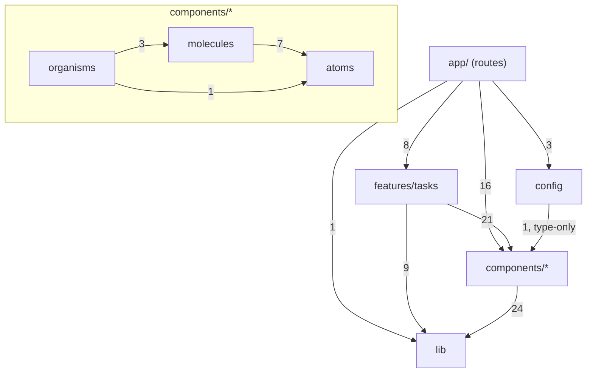

# Audit: Next.js Atomic Design Starter

- **Audit date:** 2026-10-20
- **Scope:** the entire repository (`src/`, `e2e/`, `docs/`, configuration, CI)
- **Method:** Audit first, fix later

> **Note on independence.** The repository code was written in the same working session as this audit. To reduce self-assessment bias:
>
> - Two review areas were assigned to **independent subagents**: security, and correctness/accessibility.
> - Accessibility was measured with **axe-core** in a real browser.
> - Every conclusion below comes with evidence: file:line or a command that was run.

## 1. Executive Summary

**Overall assessment: PASS WITH ISSUES.**

The Next.js implementation matches the official documentation of the installed version (16.4.2). The Hybrid Atomic Design + Feature-Based architecture is clear and is checked automatically by ESLint. The audit found:

- **1 P1 issue** (missing authentication). Not fixed automatically, because it is a design decision.
- **4 P2 issues** (all fixed):
  - path traversal via task id;
  - color contrast does not meet WCAG AA;
  - an out-of-range page shows an incorrect empty state;
  - the filter gets out of sync with the URL.
- **Several P3 issues** (mostly fixed).

**Strengths**

- Server Components are the default. There are 12 `'use client'` files, all of them interactive leaves or error boundaries (`error.tsx`, `global-error.tsx`).
- Secrets live only on the server. `server-only` is used in 5 modules. Verified: `.next/static` does not contain `API_TOKEN`, `API_BASE_URL` or `Authorization`.
- Every Server Action re-validates its input with Zod, returns errors as values, and calls `revalidatePath`.
- No circular dependencies. No reverse-direction imports (shared → feature). ESLint blocks them automatically.
- The repository pattern can switch demo ↔ REST without changing the UI. Actually run against a mock backend.
- The test suite is meaningful: 61 unit/component tests and 7 E2E tests.

**Main risks**

1. **No auth yet.** In `API_MODE=rest`, every visitor shares the server's `API_TOKEN` (P1).
2. No CSP or security headers yet (P3, recommended).
3. CI has never run on GitHub; only the equivalent commands have been run locally.

**Readiness as a template:** **ready** for starting a new project. **Not ready** for public deployment in REST mode until auth is added.

## 2. Environment and Tools

| Item              | Value (source: `package.json`, `pnpm-lock.yaml`)                  |
| ----------------- | ----------------------------------------------------------------- |
| Next.js           | 16.4.2 (`cacheComponents: true`, `partialPrefetching: true`)      |
| React / React DOM | 19.3.0                                                            |
| TypeScript        | 5.9.3 (strict)                                                    |
| Package manager   | pnpm 12.11.2 (Corepack, `packageManager`)                         |
| Styling           | Tailwind CSS 4.3.3, CSS variables, CVA                            |
| Form / validation | React Hook Form 7.90, Zod 4.6.7                                   |
| State             | React local state + URL state; no global store, no TanStack Query |
| Test              | Vitest 5.0.5 (jsdom 30), React Testing Library, Playwright 1.64   |
| Docs UI           | Storybook 10.6.2 (`@storybook/nextjs-vite`)                       |
| CI                | `.github/workflows/ci.yml` (2 jobs: quality, e2e)                 |

| Capability         | Available                                                                    | Actually used                                                                                                                                                      |
| ------------------ | ---------------------------------------------------------------------------- | ------------------------------------------------------------------------------------------------------------------------------------------------------------------ |
| Plugins            | Yes (ponytail, superpowers, feature-dev, code-modernization, engineering...) | `feature-dev` (agent `code-reviewer`), `code-modernization` (agent `security-auditor`), `ponytail` (skill `ponytail-audit`)                                        |
| Skills             | Yes                                                                          | `ponytail:ponytail-audit` (over-engineering sweep); `senior-engineer-mode` (working rules for the session)                                                         |
| Subagents          | Yes                                                                          | `feature-dev:code-reviewer` (correctness + UI a11y), `code-modernization:security-auditor` (security + `pnpm audit`). Both read-only, with non-overlapping scopes. |
| MCP tools          | Yes                                                                          | `context7` (official Next.js docs, snapshot v16.2.9), `semble` (code search)                                                                                       |
| Browser automation | Yes                                                                          | Playwright: E2E, axe-core scans, focus trap checks, dark mode screenshots                                                                                          |

**Documentation access**

- **Next.js:** the primary source is the documentation bundled with the package, matching version 16.4.2: `node_modules/next/dist/docs/` (the Markdown version of https://nextjs.org/docs).
  - Context7 only has the latest snapshot, v16.2.9, so it was used only for cross-checking (data-security, forms sections).
- **Atomic Design:** read https://atomicdesign.bradfrost.com/chapter-2/ and https://bradfrost.com/blog/post/atomic-web-design/ during the session that created the repo (WebFetch).

## 3. Next.js Compliance Review

The documentation paths below are relative to `node_modules/next/dist/docs/01-app/`. The corresponding public URLs are under https://nextjs.org/docs/app/.

| Item                              | Result                            | Evidence                                                                                                                                                                                         | Reference                                                                                       |
| --------------------------------- | --------------------------------- | ------------------------------------------------------------------------------------------------------------------------------------------------------------------------------------------------ | ----------------------------------------------------------------------------------------------- |
| App Router, route groups          | PASS                              | `src/app/(app)/layout.tsx:12`; the `(app)` group is used only to split layouts and does not affect the URL                                                                                       | `03-api-reference/03-file-conventions/route-groups.md`                                          |
| `page.tsx` / `layout.tsx`         | PASS                              | Pages only compose UI and read data; the layout mounts the template                                                                                                                              | `01-getting-started/03-layouts-and-pages.md`                                                    |
| Redirect `/`                      | PASS                              | `next.config.ts:7` (`redirects()`). Replaces `redirect()` in a page, which made the dev server report a validation error under Cache Components                                                  | `03-api-reference/05-config/01-next-config-js/redirects.md`                                     |
| Server/Client boundary            | PASS                              | 12 `'use client'` files, all interactive leaves or error boundaries; props passed across the boundary are all serializable (`icon` is an element)                                                | `01-getting-started/05-server-and-client-components.md`                                         |
| Keeping server-only out of client | PASS                              | `import 'server-only'` in `src/lib/env.ts:1`, `src/lib/api/backend.ts:1` and 3 files in `services/`; grepping `.next/static` finds no `API_TOKEN`                                                | `02-guides/data-security.md` (Preventing client-side execution)                                 |
| Data fetching / Cache Components  | PASS                              | Dynamic data sits inside `<Suspense>` (`tasks/page.tsx:30`, `dashboard/page.tsx:18`); `await connection()` in `dashboard/page.tsx:27`; the build outputs `◐` (Partial Prerender) for both routes | `01-getting-started/08-caching.md`                                                              |
| Loading UI / streaming            | PASS (valid choice)               | Uses Suspense in the page instead of `loading.tsx`, so the static header shows immediately                                                                                                       | `03-api-reference/03-file-conventions/loading.md`                                               |
| Server Actions: validation        | PASS                              | `safeParse` on `unknown` input in every action (`actions.ts:22,34-35,48-49`)                                                                                                                     | `02-guides/data-security.md` (Validating client input)                                          |
| Server Actions: expected errors   | PASS                              | Returns `ActionResult` instead of throwing                                                                                                                                                       | `01-getting-started/10-error-handling.md` (Handling expected errors)                            |
| Server Actions: authorization     | **FAIL** (P1, intentional)        | `actions.ts:13` has only a TODO comment                                                                                                                                                          | `02-guides/server-actions.md` (Security), `02-guides/production-checklist.md` (Security)        |
| Cache invalidation                | PASS                              | `revalidatePath` for `/tasks` and `/dashboard` (`actions.ts:17-18`)                                                                                                                              | `02-guides/server-actions.md` (Choosing a cache update)                                         |
| Error boundaries                  | PASS (after fix)                  | `(app)/error.tsx` uses the `retry` prop; **added** `app/global-error.tsx`                                                                                                                        | `03-api-reference/03-file-conventions/error.md` (Global Error)                                  |
| Not found                         | PASS                              | `app/not-found.tsx`                                                                                                                                                                              | `03-api-reference/03-file-conventions/not-found.md`                                             |
| Metadata API                      | PASS                              | `layout.tsx:12` has a title template; each page exports `metadata`                                                                                                                               | `01-getting-started/14-metadata-and-og-images.md`                                               |
| Env variables                     | PASS                              | Validated with Zod; only `NEXT_PUBLIC_APP_NAME` is public; `.gitignore` blocks `.env*`; `instrumentation.ts` makes the process exit on invalid configuration                                     | `02-guides/environment-variables.md`, `03-api-reference/03-file-conventions/instrumentation.md` |
| Theme without flash (no-flash)    | PASS                              | `layout.tsx:26` uses an inline script with `suppressHydrationWarning`, matching the official pattern                                                                                             | `02-guides/preventing-flash-before-hydration.md` (Themes)                                       |
| Font                              | PASS                              | `next/font/google` (Geist)                                                                                                                                                                       | `01-getting-started/13-fonts.md`                                                                |
| Forms                             | PASS WITH ISSUES (P3)             | RHF calls the action directly, so the form does not work before JS is available (no progressive enhancement)                                                                                     | `02-guides/forms.md`                                                                            |
| Security headers / CSP            | NOT IMPLEMENTED (P3, recommended) | `next.config.ts` has no `headers()`                                                                                                                                                              | `02-guides/content-security-policy.md`                                                          |

## 4. Atomic Design Compliance Review

Atomic Design is applied as a **mental model**, not as 5 mandatory technical layers. Evidence: `TaskTable` uses `DataTable` directly; `EmptyState` is used directly in the page.

- **Atoms: PASS.** `Button`, `Input`, `Textarea`, `Select`, `Checkbox`, `Label`, `Badge`, `Spinner`, `Skeleton`, `Separator`, `Card`. No atom contains domain logic.
  - Variants use CVA consistently. Accessibility: `aria-busy` for loading; `aria-invalid` is styled; icons have `aria-hidden`.
  - `Card` (a component with several sub-parts) is classified as an atom because it is only a surface frame. Debatable, but acceptable.
- **Molecules: PASS.** `FormField` combines Label + control + hint/error and wires up `aria-describedby`; it is an exemplary molecule under the "does one thing" definition.
  - `ConfirmationDialog` is built from `Dialog` + `Alert` + `Button`: composition in the proper sense.
  - No molecule is just an empty wrapper.
- **Organisms: PASS.**
  - `DataTable`: generic; the feature decides the cells.
  - `AppSidebar`, `MobileNav`: valid.
  - `AppHeader` is rather thin: a sticky container with 2 slots. Acceptable.
  - No business-specific organism lives in shared.
- **Templates: PASS (valid choice).**
  - `DashboardTemplate` has only slots (`dashboard-template.tsx`, 33 lines). `(app)/layout.tsx` (29 lines) mounts organisms and config into it.
  - The two files **do not overlap in responsibility**: the template is UI structure and viewable in Storybook; the layout is the Next.js routing mechanism.
  - Trade-off: the template has only 1 consumer. Merging it into the layout is also a valid choice, but would lose the ability to view the shell on its own in Storybook.
- **Pages: PASS WITH ISSUES (P3).**
  - `app/**/page.tsx` plays the role of the Atomic Page: template + real data. The distinction is explained clearly in `docs/architecture.md`.
  - Missing: Brad Frost stresses that Pages are where **content variations are tested**: empty, many, long titles. The repo only tests these variations through E2E; there is no "Page"-level story with representative data yet (recommendation R5).
- **Ownership: PASS.** Every component containing domain logic (`TaskTable`, `TaskForm`, `TaskStatusBadge`...) lives in `features/tasks/components/`.

## 5. Hybrid Architecture Review

The **actual** dependency graph was measured with an import-analysis script over 62 modules (excluding tests/stories), after the fixes were applied. No cycles were found:



The graph matches the designed architecture, so **no alternative architecture needs to be proposed**.

- **Feature boundaries:** there is only 1 feature, so there are no cross-feature dependencies yet. The rule "do not import another feature's internals" is written in the documentation, but ESLint does not check it yet (recommendation R7).
- **API and state:** the UI does not call `fetch`. Data is read through `taskRepository` in Server Components; writes go through Server Actions. Filter state lives in the URL; no server state is duplicated on the client.
- **Abstraction:** `TaskRepository` has 2 real implementations (demo, REST), so it has a reason to exist. The `createDemoTaskRepository` factory serves isolation between tests.

## 6. Component Classification Matrix

| Component                                                                                                                                       | Location                  | Proposed   | Assessment                                                                                                     |
| ----------------------------------------------------------------------------------------------------------------------------------------------- | ------------------------- | ---------- | -------------------------------------------------------------------------------------------------------------- |
| Button, Input, Textarea, Select, Label, Badge, Spinner, Skeleton                                                                                | atoms                     | atoms      | Correct                                                                                                        |
| Checkbox, Separator                                                                                                                             | atoms                     | atoms      | Correct; not used by the app yet but part of the original requirements. `Separator` has no story/test yet (P3) |
| Card (+ Header/Title/Description/Content/Footer)                                                                                                | atoms                     | atoms      | Ambiguous but acceptable. `CardFooter` is not used anywhere (ponytail-audit: deletion candidate)               |
| FormField, SearchInput, Pagination, EmptyState, Alert, StatCard, PageHeader, NavMenu, ThemeToggle                                               | molecules                 | molecules  | Correct                                                                                                        |
| Dialog                                                                                                                                          | molecules                 | molecules  | Ambiguous but acceptable: a behavioral primitive that combines title + close button                            |
| ConfirmationDialog                                                                                                                              | molecules                 | molecules  | Correct (composition from Dialog)                                                                              |
| AppSidebar, MobileNav, DataTable                                                                                                                | organisms                 | organisms  | Correct                                                                                                        |
| AppHeader                                                                                                                                       | organisms                 | organisms  | Correct, but thin                                                                                              |
| DashboardTemplate                                                                                                                               | templates                 | templates  | Correct; does not duplicate the layout                                                                         |
| TaskTable, TaskForm, TaskFormDialog, TaskFilters, TaskStatusSelect, DeleteTaskButton, TaskStats, RecentTasks, TaskStatusBadge/TaskPriorityBadge | features/tasks/components | keep as is | Correct (has domain logic)                                                                                     |

API inconsistency (P3): `className` on `Select` and `SearchInput` applies to the **wrapper**, while on `Input` it applies to the **control**. This is an API inconsistency, not an architecture violation.

`ponytail-audit` results (over-engineering):

- `delete:` `CardFooter`, unused and not part of the original requirements (`src/components/atoms/card.tsx`).
- No unnecessary dependencies: every package in `dependencies` is used.
- **net: −6 lines, −0 deps.**

## 7. Code Quality, Security and Performance

| ID     | Level | Finding                                                                                                                                                          | Source                                                                                   |
| ------ | ----- | ---------------------------------------------------------------------------------------------------------------------------------------------------------------- | ---------------------------------------------------------------------------------------- |
| SEC-1  | P1    | No authentication/authorization in Server Actions and pages; in REST mode, anonymous visitors act with the permissions of `API_TOKEN`                            | security-auditor; `actions.ts:13`, `backend.ts:23`                                       |
| SEC-2  | P2    | Task id `.` or `..` passes validation; `new URL` normalizes it to `/v1/tasks/` or `/v1/`, so a `DELETE` carrying the token is sent to an unintended endpoint     | security-auditor (ran a node proof); `schemas.ts` (old), `rest-task-repository.ts:34,41` |
| SEC-3  | P3    | Backend 4xx error messages (including 401/403) are shown verbatim to the user                                                                                    | `action-result.ts` (old)                                                                 |
| SEC-4  | P3    | No CSP or security headers yet. The inline theme script will need a nonce/hash once CSP is added                                                                 | `next.config.ts`                                                                         |
| SEC-5  | P3    | The demo store has no size limit and is shared by all visitors; combined with SEC-1, anyone can grow server memory                                               | `demo-task-repository.ts`                                                                |
| SEC-6  | P3    | `pnpm audit`: 1 high in the **dev dependency** `braces` (`eslint-config-next > … > micromatch`), no patch available yet. `pnpm audit --prod`: no vulnerabilities | command run                                                                              |
| A11Y-1 | P2    | Color contrast < 4.5:1: success badge (light), primary/destructive badges (dark), primary button (dark)                                                          | axe-core                                                                                 |
| A11Y-2 | P3    | Heading levels skip h1 → h3 (`CardTitle`, `EmptyState`); the 404 page has no h1                                                                                  | axe-core                                                                                 |
| A11Y-3 | P3    | The disabled "Previous" span has `aria-disabled` but no role, and no name on mobile                                                                              | code-reviewer                                                                            |
| BUG-1  | P2    | `?page=99`, or deleting the last item of the last page, wrongly shows "No tasks yet" and can lose the pagination entirely                                        | code-reviewer                                                                            |
| BUG-2  | P2    | The `TaskFilters` inputs do not resync when the URL changes from elsewhere (clicking the "Tasks" link)                                                           | code-reviewer; reproduced in E2E                                                         |
| BUG-3  | P3    | A rejected Server Action call (network loss, deploy skew) is not caught: the form fails silently; select/delete drops the whole page into the error boundary     | code-reviewer                                                                            |
| NX-1   | P3    | Missing `app/global-error.tsx`, which the production checklist recommends                                                                                        | `02-guides/production-checklist.md`                                                      |
| NX-2   | P3    | Forms have no progressive enhancement (require JS)                                                                                                               | `02-guides/forms.md`                                                                     |
| Q-1    | P3    | `formatDate` shows dates in UTC: `updatedAt` can be off by 1 day for users in UTC+7                                                                              | `src/lib/utils.ts`                                                                       |

Checked and found **no issues**:

- No XSS sink: `themeInitScript` is a constant.
- `buildUrl` cannot change the host.
- Zod strips extra fields, so there is no mass assignment.
- `NEXT_PUBLIC_*` contains no secrets.
- No hydration risk (date formatting uses a fixed locale and UTC).
- Dialog: the focus trap actually held 20/20 Tab presses.
- **Performance:** no specific, evidenced issue found. Icons are imported by name (tree-shaken), fonts use `next/font`, client boundaries are small. Next 16 no longer prints bundle sizes; measure with `next experimental-analyze` if needed.

## 8. Testing Results

All the commands below **were actually run** during the audit session, after the fixes were applied:

| Command                                                                             | Result                                                                                                       |
| ----------------------------------------------------------------------------------- | ------------------------------------------------------------------------------------------------------------ |
| `pnpm typecheck`                                                                    | Pass                                                                                                         |
| `pnpm lint`                                                                         | Pass (0 errors)                                                                                              |
| `pnpm format:check`                                                                 | Pass                                                                                                         |
| `pnpm test`                                                                         | **61/61 pass**, 12 files. Before the audit: 45 tests                                                         |
| `pnpm test:coverage`                                                                | 65.2% statements (before: 56.5%); no threshold set yet                                                       |
| `pnpm build`                                                                        | Pass; `/dashboard`, `/tasks` are `◐` Partial Prerender                                                       |
| `CI=1 pnpm test:e2e` (production server)                                            | **7/7 pass** (before: 5)                                                                                     |
| `pnpm build-storybook`                                                              | Pass                                                                                                         |
| `pnpm audit --prod` / `pnpm audit`                                                  | 0 vulnerabilities / 1 high in a dev dependency (SEC-6)                                                       |
| axe-core (WCAG 2 A/AA, 2.1 AA, best-practice), light and dark, including the dialog | After fixes: 0 violations, except the disabled "Previous" span (exempt under WCAG 1.4.3: inactive component) |
| Mutation check: disable the BUG-2 fix and rerun the tests                           | The resync test **fails** as expected, then passes again once the fix is re-enabled                          |

**Not verified (NOT VERIFIED)**

- The GitHub Actions workflow has not run on GitHub.
- The Husky pre-commit hook has not been triggered, because no commit was made.
- REST mode: reads were run against a mock backend in an earlier session; writes have only unit tests.

Test quality assessment: tests query by role and label, and check behavior rather than implementation details. Server Actions are tested with a mocked repository. Still missing: a test for the Dialog backdrop click, and Page-level stories.

## 9. Prioritized Findings

### P0: none

### P1

```text
ID: SEC-1
Severity: P1
Category: Security / Authorization
Title: Server Actions and pages have no auth; REST mode shares one service token across all visitors
Location: src/features/tasks/actions.ts:13,21,33,47,61; src/lib/api/backend.ts:23
Observed behavior: Anyone can call the 4 actions (public POST endpoints).
  In API_MODE=rest, requests carry Authorization: Bearer API_TOKEN.
Evidence: actions.ts only has an "Auth integration point" comment; there is no proxy.ts.
Reference: 02-guides/server-actions.md (Security); 02-guides/data-security.md (Authentication and authorization);
  https://nextjs.org/docs/app/guides/data-security
Why it matters: Outsiders can create, edit and delete data with the service account's permissions.
Recommended solution (decision needed, not applied):
  1. Create src/lib/auth.ts with getSession() and requireUser(), following the backend's mechanism
     (OIDC, session cookie or JWT).
  2. Call requireUser() at the start of every Server Action, and in the repository if ownership checks are needed.
  3. Switch from the service token to the user's token (httpOnly cookie) in backend.ts.
  4. Add src/proxy.ts to redirect signed-out users (an additional layer of defense).
  5. Fail-closed option: in API_MODE=rest, reject mutations when auth is not configured.
Trade-offs: The auth mechanism depends on the backend; the template deliberately does not guess it.
  The fail-closed option is safer, but REST mode will not be able to write until auth exists.
Verification: Action test returns Unauthorized without a session; E2E can only CRUD after signing in.
Done: added a warning to the README (Production section) and .env.example.
```

### P2 (fixed)

```text
ID: SEC-2 | P2 | Security | Path traversal via task id
Location: src/features/tasks/schemas.ts:59 (fixed); rest-task-repository.ts:34,41
Evidence: buildUrl('https://api.example.com/v1', '/tasks/..') => https://api.example.com/v1/
Fix: taskIdSchema = z.string().regex(/^[A-Za-z0-9_-]{1,100}$/)
Verification: schemas.test.ts (7 rejected cases), actions.test.ts ('..' does not reach the repository)
```

```text
ID: A11Y-1 | P2 | Accessibility | Color contrast below WCAG AA (1.4.3)
Location: src/app/globals.css (token --success in light; --primary, --destructive and their
  corresponding foregrounds in dark)
Fix: Light --success made darker (L 0.52 → 0.46). Dark --primary and --destructive made lighter,
  paired with dark text on the colored background (the "lighter accent + dark text" pattern).
Trade-offs: The primary button in dark mode uses dark text instead of white text (an aesthetic difference).
Verification: axe-core 0 color-contrast violations in both themes (except exempt disabled elements).
```

```text
ID: BUG-1 | P2 | Correctness | Out-of-range page shows an incorrect empty state
Location: src/app/(app)/tasks/page.tsx:65-80
Fix: When items is empty but total > 0, show an EmptyState "This page is empty" with a link
  "Go to page N" (the last page).
Trade-offs: redirect() is not used, to avoid redirecting mid-stream and during
  revalidation after an action.
Verification: E2E 'out-of-range page explains itself and links back'.
```

```text
ID: BUG-2 | P2 | Correctness | TaskFilters inputs out of sync with the URL
Location: src/features/tasks/components/task-filters.tsx:27-39
Fix: React's "adjusting state when a prop changes" pattern. Inputs are reset only when the URL change
  was NOT caused by the component's own navigation, so text the user is typing is not wiped.
Trade-offs: `key` is not used to remount, because remounting loses focus while typing.
Verification: task-filters.test.tsx (4 tests, mutation-checked); E2E 'filter inputs reset…'.
```

### P3

| ID     | Status                  | Notes                                                                                                                                                                          |
| ------ | ----------------------- | ------------------------------------------------------------------------------------------------------------------------------------------------------------------------------ |
| SEC-3  | Fixed                   | `src/lib/action-result.ts`: only messages for `VALIDATION_ERROR`, `NOT_FOUND`, `TIMEOUT`, `NETWORK_ERROR` are shown to the user; 401/403 are hidden. Test: `actions.test.ts`   |
| SEC-4  | Not fixed (recommended) | Add a nonce-based CSP per `02-guides/content-security-policy.md`, along with the `X-Content-Type-Options` and `Referrer-Policy` headers                                        |
| SEC-5  | Fixed                   | `demo-task-repository.ts:16`: `MAX_TASKS = 500`. Test: `demo-task-repository.test.ts`                                                                                          |
| SEC-6  | Tracking upstream       | Dev dependency only; no patch available yet                                                                                                                                    |
| A11Y-2 | Fixed                   | `CardTitle` renders `h2`; `EmptyState` has a `titleAs` prop (default h2); the 404 page uses h1                                                                                 |
| A11Y-3 | Fixed                   | `pagination.tsx`: the disabled span has `aria-hidden` (not operable, no need to announce it)                                                                                   |
| BUG-3  | Fixed                   | Added `callAction()` in `action-result.ts`, used in 3 client components. Test: `task-form.test.tsx`                                                                            |
| NX-1   | Fixed                   | Added `src/app/global-error.tsx`, with its own `<html>/<body>` and CSS per the documentation                                                                                   |
| NX-2   | Not fixed (trade-off)   | Progressive enhancement would require switching to `<form action>` + `useActionState` and dropping part of RHF                                                                 |
| Q-1    | Not fixed (recommended) | Use the `LocalDate` + inline script pattern from `02-guides/preventing-flash-before-hydration.md` (Dates)                                                                      |
| Q-2    | Not fixed               | `className` inconsistency in Select/SearchInput (section 6)                                                                                                                    |
| Q-3    | Not fixed               | `CardFooter` unused; `Separator` has no story/test yet                                                                                                                         |
| Q-4    | Not fixed               | No coverage threshold in `vitest.config.mts` yet                                                                                                                               |
| Q-5    | Not fixed (recommended) | `revalidatePath('/dashboard')` works correctly. Since the data is not cached yet, `refresh()` is a closer fit; once `'use cache'` is added, switch to `cacheTag` + `updateTag` |

## 10. Refactoring Roadmap

**1. Must fix (before public deployment in REST mode)**

- SEC-1: implement auth following the steps in section 9. Related files: `src/lib/auth.ts` (new), `src/features/tasks/actions.ts`, `src/lib/api/backend.ts`, `src/proxy.ts` (new), `src/app/(auth)/login/page.tsx` (new).
- Push the repo to GitHub and confirm CI is green.

**2. Should fix**

- SEC-4: CSP and security headers in `next.config.ts`. The inline theme script needs a nonce/hash.
- Q-4: set a coverage threshold (for example 70% for `src/lib` and `src/components`).
- R5: add "Page"-level stories with content variations (empty list, 1 task, 100 tasks, very long title) to properly fulfil the role of Pages per Brad Frost.
- R7: add an ESLint rule blocking `features/A` from importing `features/B/**` (currently only written in the documentation).

**3. Nice to have**

- Q-1: show dates in the user's time zone.
- Q-2: unify the `className` prop (or add `wrapperClassName`).
- Q-3: delete `CardFooter` or use it; add a story for `Separator`.
- NX-2: progressive enhancement for forms, if the no-JS case needs to be supported.

## 11. Changes Applied

| File                                                                                                                                                               | Change                                              | Finding          |
| ------------------------------------------------------------------------------------------------------------------------------------------------------------------ | --------------------------------------------------- | ---------------- |
| `src/features/tasks/schemas.ts`                                                                                                                                    | Regex allowlist for `taskIdSchema`                  | SEC-2            |
| `src/lib/action-result.ts`                                                                                                                                         | User-facing message allowlist; added `callAction()` | SEC-3, BUG-3     |
| `src/features/tasks/services/demo-task-repository.ts`                                                                                                              | `MAX_TASKS = 500`                                   | SEC-5            |
| `src/app/(app)/tasks/page.tsx`                                                                                                                                     | Empty state for out-of-range pages                  | BUG-1            |
| `src/features/tasks/components/task-filters.tsx`                                                                                                                   | Sync inputs with the URL                            | BUG-2            |
| `task-form.tsx`, `task-status-select.tsx`, `delete-task-button.tsx`                                                                                                | Wrap action calls with `callAction()`               | BUG-3            |
| `src/app/globals.css`                                                                                                                                              | Adjust tokens to meet contrast                      | A11Y-1           |
| `src/components/atoms/card.tsx`, `molecules/empty-state.tsx`, `app/not-found.tsx`, `features/tasks/components/recent-tasks.tsx`                                    | Fix heading hierarchy                               | A11Y-2           |
| `src/components/molecules/pagination.tsx`                                                                                                                          | `aria-hidden` for the disabled control              | A11Y-3           |
| `src/app/global-error.tsx` (new)                                                                                                                                   | Global error boundary                               | NX-1             |
| `README.md`, `.env.example`                                                                                                                                        | SEC-1 warning                                       | SEC-1            |
| `docs/api-integration.md`, `docs/architecture.md`                                                                                                                  | Update error-handling behavior                      | SEC-3, BUG-3     |
| New/extended tests: `task-filters.test.tsx` (new), `schemas.test.ts`, `actions.test.ts`, `demo-task-repository.test.ts`, `task-form.test.tsx`, `e2e/tasks.spec.ts` | +16 unit tests, +2 E2E                              | All of the above |

No changes to the folder structure, public component APIs, dependencies or the backend contract. The only change to a component API is that `EmptyState` gains an optional `titleAs` prop, which is not a breaking change.

## 12. Final Assessment

| Question                                 | Verdict                                                                                                                                                |
| ---------------------------------------- | ------------------------------------------------------------------------------------------------------------------------------------------------------ |
| Is Next.js implemented correctly?        | **PASS WITH ISSUES**: matches the documentation for 16.4.2; remaining issues are auth (P1, intentional) and CSP (recommended)                          |
| Is Atomic Design applied correctly?      | **PASS**: classification is justified, all 5 levels are not forced, Template and layout are kept separate; Page-level stories are missing (P3)         |
| Is the hybrid architecture maintainable? | **PASS**: no cycles, no dependency-direction violations, protected by ESLint                                                                           |
| Is it suitable as a reusable template?   | **PASS WITH ISSUES**: usable right away for Admin Dashboards, internal apps and REST applications. SaaS needs auth and multi-tenancy (not present yet) |
| What remains before production use?      | Auth (SEC-1); CI running green on GitHub; CSP and security headers; error reporting (Sentry...)                                                        |

Separating technical right/wrong from architectural preference:

- **Right/wrong with respect to the framework:** SEC-1, SEC-2, A11Y-1, BUG-1/2/3.
- **Architectural preference, not defects:** a separate Template versus merging into the layout; Suspense in the page versus `loading.tsx`; which level `Card` or `Dialog` belongs to; not using TanStack Query.

## 13. Post-audit update: Dependency Deep Audit (2026-10-20)

A deep dependency audit is now available: [`dependency-deep-audit.md`](dependency-deep-audit.md). The architecture findings above remain unchanged. The conclusions below are added or adjusted:

| Section in this report           | Update                                                                                                                                                                                                                                                                           |
| -------------------------------- | -------------------------------------------------------------------------------------------------------------------------------------------------------------------------------------------------------------------------------------------------------------------------------- |
| §2 Environment                   | `react`/`react-dom` were patch-upgraded to **19.3.1**. The App Router runs on the React bundled with Next (`19.3.0-canary-278794d7-20261002`), so the version in `package.json` only affects tooling.                                                                            |
| §2 Environment (Node)            | **New finding (P2, fixed):** `engines.node: >=22` was too broad. Changed to `^22.22.2 \|\| ^24.15.0 \|\| >=26.0.0` to match jsdom, Vitest and lint-staged; added `.nvmrc`, and CI reads the version from this file.                                                              |
| §6 "No unnecessary dependencies" | **Confirmed** with Knip and a manual check of each package.                                                                                                                                                                                                                      |
| §7 SEC-6                         | **Confirmed:** GHSA-vfj7-8cjw-p6xm / CVE-2026-93687, no patch available yet. Deeper analysis shows the vulnerable code only runs when `settings.next.rootDir` is set, and the repo does not set it. Actual severity **Low/Informational**; tracking is still all that is needed. |
| §7 Performance                   | Real measurements now exist: first-load JS `/dashboard` 187.3 KiB gzip, `/tasks` 234.1 KiB gzip. The form stack (Zod, RHF, resolver) only loads on `/tasks`, about 46 KiB gzip.                                                                                                  |
| §10 Roadmap                      | Added: track ESLint 10 (DEP-2); consider making Storybook optional (DEP-5, recommendation: keep it).                                                                                                                                                                             |

## 14. Post-audit update: Production Readiness (2026-10-20)

Details: [`production-readiness-audit.md`](production-readiness-audit.md). The original findings above are kept unchanged as a historical record.

| Item        | New status                                                                                                                                                                                                                                                                      |
| ----------- | ------------------------------------------------------------------------------------------------------------------------------------------------------------------------------------------------------------------------------------------------------------------------------- |
| SEC-1 (P1)  | **Mitigated, fail-closed.** `requireSession()` runs in Server Actions, pages and `backendRequest()`. In REST mode without auth configured, the backend receives 0 requests (verified). Real auth still awaits integration with a sign-in provider (`src/lib/auth-provider.ts`). |
| SEC-4 (CSP) | **Fixed.** CSP "Without Nonces" and security headers in `next.config.ts`; 0 CSP violations in E2E.                                                                                                                                                                              |
| CI          | Workflow passes `actionlint`; every step succeeds on a clean copy (fixed a missing `public/`). Remote still **NOT VERIFIED**.                                                                                                                                                   |
