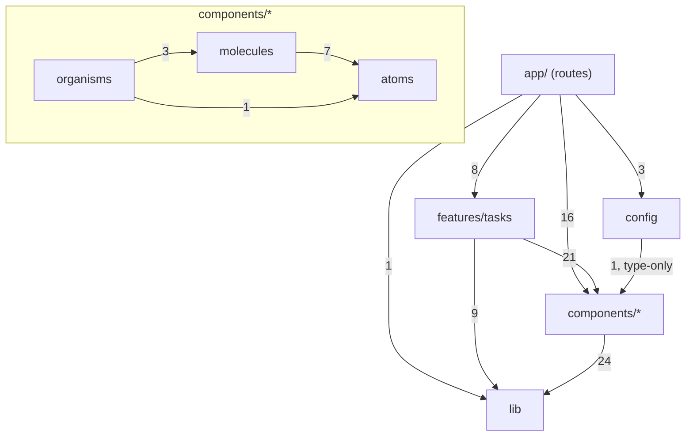

# Audit: Next.js Atomic Design Starter

- **Ngày audit:** 2026-10-20
- **Phạm vi:** toàn bộ repository (`src/`, `e2e/`, `docs/`, cấu hình, CI)
- **Phương pháp:** Audit trước, sửa sau

> **Lưu ý về tính độc lập.** Code của repository được viết trong cùng phiên làm việc với bản audit này. Để giảm thiên kiến tự đánh giá:
>
> - Hai phần review được giao cho **subagent độc lập**: security, và correctness/accessibility.
> - Accessibility được đo bằng **axe-core** trên trình duyệt thật.
> - Mỗi kết luận bên dưới đều kèm bằng chứng: file:line hoặc lệnh đã chạy.

## 1. Executive Summary

**Đánh giá chung: PASS WITH ISSUES.**

Phần triển khai Next.js đúng với tài liệu chính thức của version đang cài (16.4.2). Kiến trúc Hybrid Atomic Design + Feature-Based rõ ràng và được ESLint kiểm tra tự động. Audit tìm ra:

- **1 vấn đề P1** (thiếu authentication). Không sửa tự động, vì đây là quyết định thiết kế.
- **4 vấn đề P2** (đều đã sửa):
  - path traversal qua task id;
  - color contrast không đạt WCAG AA;
  - trang vượt phạm vi hiển thị sai empty state;
  - filter bị lệch với URL.
- **Một số vấn đề P3** (phần lớn đã sửa).

**Điểm mạnh**

- Server Components là mặc định. Có 12 file `'use client'`, tất cả là lá tương tác hoặc error boundary (`error.tsx`, `global-error.tsx`).
- Secret chỉ nằm ở server. `server-only` được dùng ở 5 module. Đã kiểm chứng: `.next/static` không chứa `API_TOKEN`, `API_BASE_URL` hay `Authorization`.
- Mọi Server Action validate lại input bằng Zod, trả lỗi dạng giá trị, và gọi `revalidatePath`.
- Không có circular dependency. Không có import ngược chiều (shared → feature). ESLint chặn tự động.
- Repository pattern đổi được demo ↔ REST mà không sửa UI. Đã chạy thật với mock backend.
- Bộ kiểm thử có ý nghĩa: 61 unit/component test và 7 E2E test.

**Rủi ro chính**

1. **Chưa có auth.** Ở `API_MODE=rest`, mọi visitor dùng chung `API_TOKEN` của server (P1).
2. Chưa có CSP và security headers (P3, khuyến nghị).
3. CI chưa từng chạy trên GitHub; mới chỉ chạy các lệnh tương đương ở local.

**Mức sẵn sàng làm template:** **sẵn sàng** để bắt đầu dự án mới. **Chưa sẵn sàng** deploy công khai ở chế độ REST cho tới khi thêm auth.

## 2. Environment and Tools

| Hạng mục          | Giá trị (nguồn: `package.json`, `pnpm-lock.yaml`)                             |
| ----------------- | ----------------------------------------------------------------------------- |
| Next.js           | 16.4.2 (`cacheComponents: true`, `partialPrefetching: true`)                  |
| React / React DOM | 19.3.0                                                                        |
| TypeScript        | 5.9.3 (strict)                                                                |
| Package manager   | pnpm 12.11.2 (Corepack, `packageManager`)                                     |
| Styling           | Tailwind CSS 4.3.3, CSS variables, CVA                                        |
| Form / validation | React Hook Form 7.90, Zod 4.6.7                                               |
| State             | React local state + URL state; không có global store, không có TanStack Query |
| Test              | Vitest 5.0.5 (jsdom 30), React Testing Library, Playwright 1.64               |
| Docs UI           | Storybook 10.6.2 (`@storybook/nextjs-vite`)                                   |
| CI                | `.github/workflows/ci.yml` (2 job: quality, e2e)                              |

| Capability         | Có sẵn                                                                      | Đã dùng thực tế                                                                                                                                                   |
| ------------------ | --------------------------------------------------------------------------- | ----------------------------------------------------------------------------------------------------------------------------------------------------------------- |
| Plugins            | Có (ponytail, superpowers, feature-dev, code-modernization, engineering...) | `feature-dev` (agent `code-reviewer`), `code-modernization` (agent `security-auditor`), `ponytail` (skill `ponytail-audit`)                                       |
| Skills             | Có                                                                          | `ponytail:ponytail-audit` (rà over-engineering); `senior-engineer-mode` (quy tắc làm việc của phiên)                                                              |
| Subagents          | Có                                                                          | `feature-dev:code-reviewer` (correctness + a11y UI), `code-modernization:security-auditor` (security + `pnpm audit`). Cả hai read-only, phạm vi không chồng nhau. |
| MCP tools          | Có                                                                          | `context7` (tài liệu Next.js chính thức, snapshot v16.2.9), `semble` (code search)                                                                                |
| Browser automation | Có                                                                          | Playwright: E2E, quét axe-core, kiểm tra focus trap, screenshot dark mode                                                                                         |

**Truy cập tài liệu**

- **Next.js:** nguồn chính là tài liệu đi kèm package, đúng version 16.4.2: `node_modules/next/dist/docs/` (bản Markdown của https://nextjs.org/docs).
  - Context7 chỉ có snapshot mới nhất là v16.2.9, nên chỉ dùng để đối chiếu (mục data-security, forms).
- **Atomic Design:** đã đọc https://atomicdesign.bradfrost.com/chapter-2/ và https://bradfrost.com/blog/post/atomic-web-design/ trong phiên tạo repo (WebFetch).

## 3. Next.js Compliance Review

Đường dẫn tài liệu bên dưới là tương đối so với `node_modules/next/dist/docs/01-app/`. URL công khai tương ứng nằm dưới https://nextjs.org/docs/app/.

| Hạng mục                         | Kết quả                           | Bằng chứng                                                                                                                                                                            | Tham chiếu                                                                                      |
| -------------------------------- | --------------------------------- | ------------------------------------------------------------------------------------------------------------------------------------------------------------------------------------- | ----------------------------------------------------------------------------------------------- |
| App Router, route groups         | PASS                              | `src/app/(app)/layout.tsx:12`; group `(app)` chỉ dùng để chia layout, không ảnh hưởng URL                                                                                             | `03-api-reference/03-file-conventions/route-groups.md`                                          |
| `page.tsx` / `layout.tsx`        | PASS                              | Page chỉ ghép UI và đọc dữ liệu; layout lắp template                                                                                                                                  | `01-getting-started/03-layouts-and-pages.md`                                                    |
| Redirect `/`                     | PASS                              | `next.config.ts:7` (`redirects()`). Thay cho `redirect()` trong page, vốn làm dev server báo lỗi validate dưới Cache Components                                                       | `03-api-reference/05-config/01-next-config-js/redirects.md`                                     |
| Server/Client boundary           | PASS                              | 12 file `'use client'`, đều là lá tương tác hoặc error boundary; props truyền qua ranh giới đều serialize được (`icon` là element)                                                    | `01-getting-started/05-server-and-client-components.md`                                         |
| Chặn server-only khỏi client     | PASS                              | `import 'server-only'` ở `src/lib/env.ts:1`, `src/lib/api/backend.ts:1` và 3 file trong `services/`; grep `.next/static` không thấy `API_TOKEN`                                       | `02-guides/data-security.md` (Preventing client-side execution)                                 |
| Data fetching / Cache Components | PASS                              | Dữ liệu động nằm trong `<Suspense>` (`tasks/page.tsx:30`, `dashboard/page.tsx:18`); `await connection()` ở `dashboard/page.tsx:27`; build ra `◐` (Partial Prerender) cho cả hai route | `01-getting-started/08-caching.md`                                                              |
| Loading UI / streaming           | PASS (lựa chọn hợp lệ)            | Dùng Suspense trong page thay cho `loading.tsx`, nên header tĩnh hiển thị ngay                                                                                                        | `03-api-reference/03-file-conventions/loading.md`                                               |
| Server Actions: validation       | PASS                              | `safeParse` trên input `unknown` ở mọi action (`actions.ts:22,34-35,48-49`)                                                                                                           | `02-guides/data-security.md` (Validating client input)                                          |
| Server Actions: lỗi dự kiến      | PASS                              | Trả `ActionResult` thay vì throw                                                                                                                                                      | `01-getting-started/10-error-handling.md` (Handling expected errors)                            |
| Server Actions: authorization    | **FAIL** (P1, có chủ đích)        | `actions.ts:13` chỉ có ghi chú TODO                                                                                                                                                   | `02-guides/server-actions.md` (Security), `02-guides/production-checklist.md` (Security)        |
| Cache invalidation               | PASS                              | `revalidatePath` cho `/tasks` và `/dashboard` (`actions.ts:17-18`)                                                                                                                    | `02-guides/server-actions.md` (Choosing a cache update)                                         |
| Error boundaries                 | PASS (sau khi sửa)                | `(app)/error.tsx` dùng prop `retry`; **đã thêm** `app/global-error.tsx`                                                                                                               | `03-api-reference/03-file-conventions/error.md` (Global Error)                                  |
| Not found                        | PASS                              | `app/not-found.tsx`                                                                                                                                                                   | `03-api-reference/03-file-conventions/not-found.md`                                             |
| Metadata API                     | PASS                              | `layout.tsx:12` có title template; mỗi page export `metadata`                                                                                                                         | `01-getting-started/14-metadata-and-og-images.md`                                               |
| Env variables                    | PASS                              | Validate bằng Zod; chỉ `NEXT_PUBLIC_APP_NAME` là public; `.gitignore` chặn `.env*`; `instrumentation.ts` cho process thoát khi cấu hình sai                                           | `02-guides/environment-variables.md`, `03-api-reference/03-file-conventions/instrumentation.md` |
| Theme không nháy (no-flash)      | PASS                              | `layout.tsx:26` dùng inline script kèm `suppressHydrationWarning`, khớp mẫu chính thức                                                                                                | `02-guides/preventing-flash-before-hydration.md` (Themes)                                       |
| Font                             | PASS                              | `next/font/google` (Geist)                                                                                                                                                            | `01-getting-started/13-fonts.md`                                                                |
| Forms                            | PASS WITH ISSUES (P3)             | RHF gọi action trực tiếp, nên form không hoạt động khi chưa có JS (không có progressive enhancement)                                                                                  | `02-guides/forms.md`                                                                            |
| Security headers / CSP           | NOT IMPLEMENTED (P3, khuyến nghị) | `next.config.ts` không có `headers()`                                                                                                                                                 | `02-guides/content-security-policy.md`                                                          |

## 4. Atomic Design Compliance Review

Atomic Design được áp dụng như **mô hình tư duy**, không phải 5 tầng kỹ thuật bắt buộc. Bằng chứng: `TaskTable` dùng thẳng `DataTable`; `EmptyState` dùng thẳng trong page.

- **Atoms: PASS.** `Button`, `Input`, `Textarea`, `Select`, `Checkbox`, `Label`, `Badge`, `Spinner`, `Skeleton`, `Separator`, `Card`. Không atom nào chứa logic domain.
  - Variant dùng CVA một cách nhất quán. Accessibility: `aria-busy` cho loading; `aria-invalid` được tạo style; icon có `aria-hidden`.
  - `Card` (component có nhiều phần con) được xếp là atom vì nó chỉ là một khung bề mặt. Có thể tranh luận, nhưng chấp nhận được.
- **Molecules: PASS.** `FormField` ghép Label + control + hint/error và nối `aria-describedby`; đây là molecule mẫu mực theo đúng định nghĩa "làm một việc".
  - `ConfirmationDialog` được dựng từ `Dialog` + `Alert` + `Button`: composition đúng nghĩa.
  - Không có molecule nào chỉ là wrapper rỗng.
- **Organisms: PASS.**
  - `DataTable`: generic; ô do feature quyết định.
  - `AppSidebar`, `MobileNav`: hợp lệ.
  - `AppHeader` khá mỏng: một container sticky với 2 slot. Chấp nhận được.
  - Không có organism mang nghiệp vụ nằm trong shared.
- **Templates: PASS (lựa chọn hợp lệ).**
  - `DashboardTemplate` chỉ có slot (`dashboard-template.tsx`, 33 dòng). `(app)/layout.tsx` (29 dòng) lắp organisms và config vào đó.
  - Hai file **không trùng trách nhiệm**: template là cấu trúc UI và xem được trong Storybook; layout là cơ chế routing của Next.js.
  - Đánh đổi: template chỉ có 1 consumer. Gộp vào layout cũng là một lựa chọn hợp lệ, nhưng sẽ mất khả năng xem shell độc lập trong Storybook.
- **Pages: PASS WITH ISSUES (P3).**
  - `app/**/page.tsx` đóng vai trò Atomic Page: template + dữ liệu thật. Sự phân biệt được giải thích rõ ở `docs/architecture.md`.
  - Thiếu: Brad Frost nhấn mạnh Pages là nơi **kiểm tra biến thể nội dung**: rỗng, nhiều, tiêu đề dài. Repo chỉ kiểm tra các biến thể này qua E2E, chưa có story cấp "Page" với dữ liệu đại diện (khuyến nghị R5).
- **Ownership: PASS.** Mọi component chứa domain (`TaskTable`, `TaskForm`, `TaskStatusBadge`...) nằm trong `features/tasks/components/`.

## 5. Hybrid Architecture Review

Đồ thị phụ thuộc **thực tế** được đo bằng script phân tích import trên 62 module (bỏ qua test/story), sau khi áp dụng các bản sửa. Không phát hiện chu trình:



Đồ thị khớp với kiến trúc đã thiết kế, nên **không cần đề xuất kiến trúc thay thế**.

- **Feature boundaries:** chỉ có 1 feature, nên chưa có phụ thuộc chéo giữa các feature. Quy tắc "không import nội bộ feature khác" đã được ghi trong tài liệu, nhưng ESLint chưa kiểm tra (khuyến nghị R7).
- **API và state:** UI không gọi `fetch`. Đọc dữ liệu qua `taskRepository` trong Server Component; ghi qua Server Action. State của filter nằm trên URL; không có server state bị nhân đôi ở client.
- **Abstraction:** `TaskRepository` có 2 implementation thật (demo, REST), nên có lý do tồn tại. Factory `createDemoTaskRepository` phục vụ cách ly giữa các test.

## 6. Component Classification Matrix

| Component                                                                                                                                       | Vị trí                    | Đề xuất    | Đánh giá                                                                                     |
| ----------------------------------------------------------------------------------------------------------------------------------------------- | ------------------------- | ---------- | -------------------------------------------------------------------------------------------- |
| Button, Input, Textarea, Select, Label, Badge, Spinner, Skeleton                                                                                | atoms                     | atoms      | Đúng                                                                                         |
| Checkbox, Separator                                                                                                                             | atoms                     | atoms      | Đúng; app chưa dùng nhưng có trong yêu cầu ban đầu. `Separator` chưa có story/test (P3)      |
| Card (+ Header/Title/Description/Content/Footer)                                                                                                | atoms                     | atoms      | Mơ hồ nhưng chấp nhận được. `CardFooter` chưa được dùng ở đâu (ponytail-audit: ứng viên xóa) |
| FormField, SearchInput, Pagination, EmptyState, Alert, StatCard, PageHeader, NavMenu, ThemeToggle                                               | molecules                 | molecules  | Đúng                                                                                         |
| Dialog                                                                                                                                          | molecules                 | molecules  | Mơ hồ nhưng chấp nhận được: là primitive hành vi, ghép title + close button                  |
| ConfirmationDialog                                                                                                                              | molecules                 | molecules  | Đúng (composition từ Dialog)                                                                 |
| AppSidebar, MobileNav, DataTable                                                                                                                | organisms                 | organisms  | Đúng                                                                                         |
| AppHeader                                                                                                                                       | organisms                 | organisms  | Đúng, nhưng mỏng                                                                             |
| DashboardTemplate                                                                                                                               | templates                 | templates  | Đúng; không trùng với layout                                                                 |
| TaskTable, TaskForm, TaskFormDialog, TaskFilters, TaskStatusSelect, DeleteTaskButton, TaskStats, RecentTasks, TaskStatusBadge/TaskPriorityBadge | features/tasks/components | giữ nguyên | Đúng (có domain)                                                                             |

Bất nhất API (P3): `className` của `Select` và `SearchInput` áp vào **wrapper**, còn `Input` áp vào **control**. Đây là bất nhất về API, không phải vi phạm kiến trúc.

Kết quả `ponytail-audit` (over-engineering):

- `delete:` `CardFooter`, không được dùng và không nằm trong yêu cầu ban đầu (`src/components/atoms/card.tsx`).
- Không có dependency thừa: mọi package trong `dependencies` đều được dùng.
- **net: −6 dòng, −0 deps.**

## 7. Code Quality, Security and Performance

| ID     | Mức | Phát hiện                                                                                                                                                 | Nguồn                                                                                          |
| ------ | --- | --------------------------------------------------------------------------------------------------------------------------------------------------------- | ---------------------------------------------------------------------------------------------- |
| SEC-1  | P1  | Không có authentication/authorization ở Server Actions và pages; ở REST mode, visitor ẩn danh dùng quyền của `API_TOKEN`                                  | security-auditor; `actions.ts:13`, `backend.ts:23`                                             |
| SEC-2  | P2  | Task id `.` hoặc `..` qua được validate; `new URL` chuẩn hóa thành `/v1/tasks/` hoặc `/v1/`, nên `DELETE` có token được gửi tới endpoint ngoài ý muốn     | security-auditor (đã chạy node chứng minh); `schemas.ts` (cũ), `rest-task-repository.ts:34,41` |
| SEC-3  | P3  | Message lỗi 4xx của backend (kể cả 401/403) được hiển thị nguyên văn cho người dùng                                                                       | `action-result.ts` (cũ)                                                                        |
| SEC-4  | P3  | Chưa có CSP và security headers. Inline theme script sẽ cần nonce/hash khi thêm CSP                                                                       | `next.config.ts`                                                                               |
| SEC-5  | P3  | Demo store không giới hạn kích thước và dùng chung cho mọi visitor; kết hợp với SEC-1, ai cũng có thể làm tăng bộ nhớ server                              | `demo-task-repository.ts`                                                                      |
| SEC-6  | P3  | `pnpm audit`: 1 lỗi high trong **dev dependency** `braces` (`eslint-config-next > … > micromatch`), chưa có bản vá. `pnpm audit --prod`: không có lỗ hổng | lệnh đã chạy                                                                                   |
| A11Y-1 | P2  | Color contrast < 4.5:1: badge success (light), badge primary/destructive (dark), nút primary (dark)                                                       | axe-core                                                                                       |
| A11Y-2 | P3  | Heading nhảy cấp h1 → h3 (`CardTitle`, `EmptyState`); trang 404 không có h1                                                                               | axe-core                                                                                       |
| A11Y-3 | P3  | Span "Previous" bị disabled có `aria-disabled` nhưng không có role, và không có tên trên mobile                                                           | code-reviewer                                                                                  |
| BUG-1  | P2  | `?page=99`, hoặc xóa item cuối của trang cuối, hiển thị "No tasks yet" sai sự thật và có thể mất luôn pagination                                          | code-reviewer                                                                                  |
| BUG-2  | P2  | Input của `TaskFilters` không đồng bộ lại khi URL đổi từ nơi khác (click link "Tasks")                                                                    | code-reviewer; E2E đã tái hiện                                                                 |
| BUG-3  | P3  | Lời gọi Server Action bị reject (mất mạng, deploy skew) không được bắt: form im lặng; select/delete làm cả trang rơi vào error boundary                   | code-reviewer                                                                                  |
| NX-1   | P3  | Thiếu `app/global-error.tsx`, được production checklist khuyến nghị                                                                                       | `02-guides/production-checklist.md`                                                            |
| NX-2   | P3  | Form không progressive enhancement (cần JS)                                                                                                               | `02-guides/forms.md`                                                                           |
| Q-1    | P3  | `formatDate` hiển thị ngày theo UTC: `updatedAt` có thể lệch 1 ngày với người dùng ở UTC+7                                                                | `src/lib/utils.ts`                                                                             |

Đã kiểm tra và **không có vấn đề**:

- Không có XSS sink: `themeInitScript` là hằng số.
- `buildUrl` không thể đổi host.
- Zod loại bỏ field thừa, nên không có mass assignment.
- `NEXT_PUBLIC_*` không chứa secret.
- Không có hydration risk (format ngày cố định locale và UTC).
- Dialog: focus trap thực tế giữ được 20/20 lần Tab.
- **Performance:** không phát hiện vấn đề cụ thể có bằng chứng. Icon import theo tên (tree-shaken), font dùng `next/font`, ranh giới client nhỏ. Next 16 không còn in kích thước bundle; nên đo bằng `next experimental-analyze` nếu cần.

## 8. Testing Results

Tất cả các lệnh dưới đây **đã chạy thật** trong phiên audit, sau khi áp dụng các bản sửa:

| Lệnh                                                                        | Kết quả                                                                                                 |
| --------------------------------------------------------------------------- | ------------------------------------------------------------------------------------------------------- |
| `pnpm typecheck`                                                            | Pass                                                                                                    |
| `pnpm lint`                                                                 | Pass (0 lỗi)                                                                                            |
| `pnpm format:check`                                                         | Pass                                                                                                    |
| `pnpm test`                                                                 | **61/61 pass**, 12 file. Trước audit: 45 test                                                           |
| `pnpm test:coverage`                                                        | 65.2% statements (trước: 56.5%); chưa đặt ngưỡng                                                        |
| `pnpm build`                                                                | Pass; `/dashboard`, `/tasks` là `◐` Partial Prerender                                                   |
| `CI=1 pnpm test:e2e` (production server)                                    | **7/7 pass** (trước: 5)                                                                                 |
| `pnpm build-storybook`                                                      | Pass                                                                                                    |
| `pnpm audit --prod` / `pnpm audit`                                          | 0 lỗ hổng / 1 lỗi high ở dev dependency (SEC-6)                                                         |
| axe-core (WCAG 2 A/AA, 2.1 AA, best-practice), light và dark, gồm cả dialog | Sau khi sửa: 0 vi phạm, trừ span "Previous" bị disabled (được miễn theo WCAG 1.4.3: inactive component) |
| Kiểm tra mutation: tắt bản sửa BUG-2 rồi chạy lại test                      | Test resync **fail** như mong đợi, rồi pass lại khi bật bản sửa                                         |

**Chưa kiểm chứng (NOT VERIFIED)**

- Workflow GitHub Actions chưa chạy trên GitHub.
- Husky pre-commit chưa được kích hoạt, vì không có commit nào được tạo.
- REST mode: phần đọc đã chạy với mock backend trong phiên trước; phần ghi chỉ có unit test.

Đánh giá chất lượng test: test query theo role và label, kiểm tra hành vi chứ không kiểm tra chi tiết triển khai. Server Action được test với repository đã mock. Còn thiếu: test cho backdrop click của Dialog, và story cấp Page.

## 9. Prioritized Findings

### P0: không có

### P1

```text
ID: SEC-1
Severity: P1
Category: Security / Authorization
Title: Server Actions và pages không có auth; REST mode dùng chung service token cho mọi visitor
Location: src/features/tasks/actions.ts:13,21,33,47,61; src/lib/api/backend.ts:23
Observed behavior: Bất kỳ ai cũng có thể gọi 4 action (endpoint POST public).
  Ở API_MODE=rest, request mang theo Authorization: Bearer API_TOKEN.
Evidence: actions.ts chỉ có ghi chú "Auth integration point"; không có proxy.ts.
Reference: 02-guides/server-actions.md (Security); 02-guides/data-security.md (Authentication and authorization);
  https://nextjs.org/docs/app/guides/data-security
Why it matters: Người ngoài có thể tạo, sửa, xóa dữ liệu với quyền của service account.
Recommended solution (cần quyết định, chưa áp dụng):
  1. Tạo src/lib/auth.ts với getSession() và requireUser(), theo cơ chế của backend
     (OIDC, session cookie hoặc JWT).
  2. Gọi requireUser() đầu mỗi Server Action, và trong repository nếu cần kiểm tra quyền sở hữu.
  3. Chuyển từ service token sang token của user (cookie httpOnly) trong backend.ts.
  4. Thêm src/proxy.ts để redirect người chưa đăng nhập (lớp phòng thủ bổ sung).
  5. Tùy chọn fail-closed: ở API_MODE=rest, từ chối mutation khi chưa cấu hình auth.
Trade-offs: Cơ chế auth phụ thuộc backend; template cố ý không đoán trước.
  Phương án fail-closed an toàn hơn, nhưng REST mode sẽ không ghi được cho tới khi có auth.
Verification: Test action trả Unauthorized khi chưa có session; E2E đăng nhập rồi mới CRUD được.
Đã làm: thêm cảnh báo trong README (mục Production) và .env.example.
```

### P2 (đã sửa)

```text
ID: SEC-2 | P2 | Security | Path traversal qua task id
Location: src/features/tasks/schemas.ts:59 (đã sửa); rest-task-repository.ts:34,41
Evidence: buildUrl('https://api.example.com/v1', '/tasks/..') => https://api.example.com/v1/
Fix: taskIdSchema = z.string().regex(/^[A-Za-z0-9_-]{1,100}$/)
Verification: schemas.test.ts (7 trường hợp bị từ chối), actions.test.ts ('..' không gọi tới repository)
```

```text
ID: A11Y-1 | P2 | Accessibility | Color contrast dưới chuẩn WCAG AA (1.4.3)
Location: src/app/globals.css (token --success ở light; --primary, --destructive và các
  foreground tương ứng ở dark)
Fix: Light --success làm tối hơn (L 0.52 → 0.46). Dark --primary và --destructive làm sáng hơn,
  đi kèm chữ tối cho phần nền màu (mẫu "lighter accent + dark text").
Trade-offs: Nút primary ở dark mode dùng chữ tối thay vì chữ trắng (khác biệt thẩm mỹ).
Verification: axe-core 0 vi phạm color-contrast ở cả hai theme (trừ phần tử disabled được miễn).
```

```text
ID: BUG-1 | P2 | Correctness | Trang vượt phạm vi hiển thị empty state sai
Location: src/app/(app)/tasks/page.tsx:65-80
Fix: Khi items rỗng nhưng total > 0, hiển thị EmptyState "This page is empty" kèm link
  "Go to page N" (trang cuối).
Trade-offs: Không dùng redirect(), để tránh redirect giữa lúc đang stream và giữa lúc
  revalidate sau action.
Verification: E2E 'out-of-range page explains itself and links back'.
```

```text
ID: BUG-2 | P2 | Correctness | Input của TaskFilters lệch với URL
Location: src/features/tasks/components/task-filters.tsx:27-39
Fix: Mẫu "điều chỉnh state khi prop đổi" của React. Chỉ reset input khi URL đổi KHÔNG phải
  do chính component điều hướng, nên không xóa chữ người dùng đang gõ.
Trade-offs: Không dùng `key` để remount, vì remount làm mất focus khi đang gõ.
Verification: task-filters.test.tsx (4 test, đã kiểm tra mutation); E2E 'filter inputs reset…'.
```

### P3

| ID     | Trạng thái             | Ghi chú                                                                                                                                                                       |
| ------ | ---------------------- | ----------------------------------------------------------------------------------------------------------------------------------------------------------------------------- |
| SEC-3  | Đã sửa                 | `src/lib/action-result.ts`: chỉ cho phép message của `VALIDATION_ERROR`, `NOT_FOUND`, `TIMEOUT`, `NETWORK_ERROR` hiển thị cho người dùng; ẩn 401/403. Test: `actions.test.ts` |
| SEC-4  | Chưa sửa (khuyến nghị) | Thêm CSP có nonce theo `02-guides/content-security-policy.md`, cùng các header `X-Content-Type-Options` và `Referrer-Policy`                                                  |
| SEC-5  | Đã sửa                 | `demo-task-repository.ts:16`: `MAX_TASKS = 500`. Test: `demo-task-repository.test.ts`                                                                                         |
| SEC-6  | Theo dõi upstream      | Chỉ ở dev dependency; chưa có bản vá                                                                                                                                          |
| A11Y-2 | Đã sửa                 | `CardTitle` render `h2`; `EmptyState` có prop `titleAs` (mặc định h2); trang 404 dùng h1                                                                                      |
| A11Y-3 | Đã sửa                 | `pagination.tsx`: span disabled có `aria-hidden` (không thao tác được, không cần thông báo)                                                                                   |
| BUG-3  | Đã sửa                 | Thêm `callAction()` trong `action-result.ts`, dùng ở 3 component client. Test: `task-form.test.tsx`                                                                           |
| NX-1   | Đã sửa                 | Thêm `src/app/global-error.tsx`, có `<html>/<body>` và CSS riêng theo tài liệu                                                                                                |
| NX-2   | Chưa sửa (đánh đổi)    | Muốn progressive enhancement phải chuyển sang `<form action>` + `useActionState` và bỏ bớt RHF                                                                                |
| Q-1    | Chưa sửa (khuyến nghị) | Dùng mẫu `LocalDate` + inline script trong `02-guides/preventing-flash-before-hydration.md` (Dates)                                                                           |
| Q-2    | Chưa sửa               | Bất nhất `className` ở Select/SearchInput (mục 6)                                                                                                                             |
| Q-3    | Chưa sửa               | `CardFooter` không dùng; `Separator` chưa có story/test                                                                                                                       |
| Q-4    | Chưa sửa               | Chưa có ngưỡng coverage trong `vitest.config.mts`                                                                                                                             |
| Q-5    | Chưa sửa (khuyến nghị) | `revalidatePath('/dashboard')` hoạt động đúng. Vì dữ liệu chưa cache, `refresh()` sát nghĩa hơn; khi thêm `'use cache'` thì nên chuyển sang `cacheTag` + `updateTag`          |

## 10. Refactoring Roadmap

**1. Must fix (trước khi deploy công khai ở REST mode)**

- SEC-1: triển khai auth theo các bước trong mục 9. File liên quan: `src/lib/auth.ts` (mới), `src/features/tasks/actions.ts`, `src/lib/api/backend.ts`, `src/proxy.ts` (mới), `src/app/(auth)/login/page.tsx` (mới).
- Đẩy repo lên GitHub và xác nhận CI xanh.

**2. Should fix**

- SEC-4: CSP và security headers trong `next.config.ts`. Inline theme script cần nonce/hash.
- Q-4: đặt ngưỡng coverage (ví dụ 70% cho `src/lib` và `src/components`).
- R5: thêm story cấp "Page" với biến thể nội dung (danh sách rỗng, 1 task, 100 task, tiêu đề rất dài) để làm đúng vai trò Pages theo Brad Frost.
- R7: thêm rule ESLint chặn `features/A` import `features/B/**` (hiện mới chỉ ghi trong tài liệu).

**3. Nice to have**

- Q-1: hiển thị ngày theo múi giờ người dùng.
- Q-2: thống nhất prop `className` (hoặc thêm `wrapperClassName`).
- Q-3: xóa `CardFooter` hoặc dùng nó; thêm story cho `Separator`.
- NX-2: progressive enhancement cho form, nếu cần hỗ trợ trường hợp không có JS.

## 11. Changes Applied

| File                                                                                                                                                             | Thay đổi                                              | Finding         |
| ---------------------------------------------------------------------------------------------------------------------------------------------------------------- | ----------------------------------------------------- | --------------- |
| `src/features/tasks/schemas.ts`                                                                                                                                  | Allowlist regex cho `taskIdSchema`                    | SEC-2           |
| `src/lib/action-result.ts`                                                                                                                                       | Allowlist message cho người dùng; thêm `callAction()` | SEC-3, BUG-3    |
| `src/features/tasks/services/demo-task-repository.ts`                                                                                                            | `MAX_TASKS = 500`                                     | SEC-5           |
| `src/app/(app)/tasks/page.tsx`                                                                                                                                   | Empty state cho trang vượt phạm vi                    | BUG-1           |
| `src/features/tasks/components/task-filters.tsx`                                                                                                                 | Đồng bộ input với URL                                 | BUG-2           |
| `task-form.tsx`, `task-status-select.tsx`, `delete-task-button.tsx`                                                                                              | Bọc lời gọi action bằng `callAction()`                | BUG-3           |
| `src/app/globals.css`                                                                                                                                            | Chỉnh token để đạt contrast                           | A11Y-1          |
| `src/components/atoms/card.tsx`, `molecules/empty-state.tsx`, `app/not-found.tsx`, `features/tasks/components/recent-tasks.tsx`                                  | Sửa thứ bậc heading                                   | A11Y-2          |
| `src/components/molecules/pagination.tsx`                                                                                                                        | `aria-hidden` cho control disabled                    | A11Y-3          |
| `src/app/global-error.tsx` (mới)                                                                                                                                 | Global error boundary                                 | NX-1            |
| `README.md`, `.env.example`                                                                                                                                      | Cảnh báo SEC-1                                        | SEC-1           |
| `docs/api-integration.md`, `docs/architecture.md`                                                                                                                | Cập nhật hành vi xử lý lỗi                            | SEC-3, BUG-3    |
| Test mới/mở rộng: `task-filters.test.tsx` (mới), `schemas.test.ts`, `actions.test.ts`, `demo-task-repository.test.ts`, `task-form.test.tsx`, `e2e/tasks.spec.ts` | +16 unit test, +2 E2E                                 | Tất cả mục trên |

Không có thay đổi nào ở cấu trúc thư mục, API công khai của component, dependency hay contract với backend. Thay đổi duy nhất ở API component là `EmptyState` thêm prop tùy chọn `titleAs`, không gây breaking change.

## 12. Final Assessment

| Câu hỏi                                    | Verdict                                                                                                                               |
| ------------------------------------------ | ------------------------------------------------------------------------------------------------------------------------------------- |
| Next.js có được triển khai đúng không?     | **PASS WITH ISSUES**: đúng với tài liệu của bản 16.4.2; vấn đề còn lại là auth (P1, có chủ đích) và CSP (khuyến nghị)                 |
| Atomic Design có được áp dụng đúng không?  | **PASS**: phân loại có lý do, không ép đủ 5 cấp, Template và layout được tách bạch; thiếu story cấp Page (P3)                         |
| Kiến trúc hybrid có dễ bảo trì không?      | **PASS**: không có chu trình, không vi phạm chiều phụ thuộc, có ESLint bảo vệ                                                         |
| Có phù hợp làm template tái sử dụng không? | **PASS WITH ISSUES**: dùng được ngay cho Admin Dashboard, Internal app và ứng dụng REST. SaaS cần thêm auth và multi-tenant (chưa có) |
| Còn gì trước khi dùng cho production?      | Auth (SEC-1); CI chạy xanh trên GitHub; CSP và security headers; error reporting (Sentry...)                                          |

Tách bạch giữa đúng/sai kỹ thuật và sở thích kiến trúc:

- **Đúng/sai về framework:** SEC-1, SEC-2, A11Y-1, BUG-1/2/3.
- **Sở thích kiến trúc, không phải lỗi:** Template riêng so với gộp vào layout; Suspense trong page so với `loading.tsx`; `Card` hay `Dialog` thuộc cấp nào; không dùng TanStack Query.

## 13. Cập nhật sau audit: Dependency Deep Audit (2026-10-20)

Đã có một audit chuyên sâu về dependency: [`dependency-deep-audit.md`](dependency-deep-audit.md). Các phát hiện kiến trúc ở trên giữ nguyên. Các kết luận dưới đây được bổ sung hoặc điều chỉnh:

| Mục trong báo cáo này         | Cập nhật                                                                                                                                                                                                                                           |
| ----------------------------- | -------------------------------------------------------------------------------------------------------------------------------------------------------------------------------------------------------------------------------------------------- |
| §2 Environment                | `react`/`react-dom` được nâng patch lên **19.3.1**. App Router chạy bằng React đi kèm Next (`19.3.0-canary-278794d7-20261002`), nên version trong `package.json` chỉ ảnh hưởng tới tooling.                                                        |
| §2 Environment (Node)         | **Phát hiện mới (P2, đã sửa):** `engines.node: >=22` quá rộng. Đã sửa thành `^22.22.2 \|\| ^24.15.0 \|\| >=26.0.0` để khớp với jsdom, Vitest và lint-staged; thêm `.nvmrc`, và CI đọc version từ file này.                                         |
| §6 "Không có dependency thừa" | **Được xác nhận** bằng Knip và kiểm tra thủ công từng package.                                                                                                                                                                                     |
| §7 SEC-6                      | **Được xác nhận:** GHSA-vfj7-8cjw-p6xm / CVE-2026-93687, chưa có bản vá. Phân tích sâu hơn cho thấy code dính lỗi chỉ chạy khi có `settings.next.rootDir`, mà repo không đặt setting này. Mức thực tế **Low/Informational**; vẫn chỉ cần theo dõi. |
| §7 Performance                | Đã có số đo thực tế: first-load JS `/dashboard` 187.3 KiB gzip, `/tasks` 234.1 KiB gzip. Stack form (Zod, RHF, resolver) chỉ tải ở `/tasks`, khoảng 46 KiB gzip.                                                                                   |
| §10 Roadmap                   | Thêm: theo dõi ESLint 10 (DEP-2); cân nhắc tách Storybook thành tùy chọn (DEP-5, khuyến nghị giữ).                                                                                                                                                 |

## 14. Cập nhật sau audit: Production Readiness (2026-10-20)

Chi tiết: [`production-readiness-audit.md`](production-readiness-audit.md). Các phát hiện gốc ở trên được giữ nguyên để làm lịch sử.

| Mục         | Trạng thái mới                                                                                                                                                                                                                                                 |
| ----------- | -------------------------------------------------------------------------------------------------------------------------------------------------------------------------------------------------------------------------------------------------------------- |
| SEC-1 (P1)  | **Đã giảm thiểu, fail-closed.** `requireSession()` chạy ở Server Actions, pages và `backendRequest()`. Ở REST mode chưa cấu hình auth, backend nhận 0 request (đã kiểm chứng). Auth thật vẫn chờ tích hợp nhà cung cấp đăng nhập (`src/lib/auth-provider.ts`). |
| SEC-4 (CSP) | **Đã sửa.** CSP "Without Nonces" và các security header trong `next.config.ts`; 0 vi phạm CSP trong E2E.                                                                                                                                                       |
| CI          | Workflow qua `actionlint`; mọi bước chạy thành công trên bản copy sạch (đã sửa lỗi thiếu `public/`). Remote vẫn **NOT VERIFIED**.                                                                                                                              |
